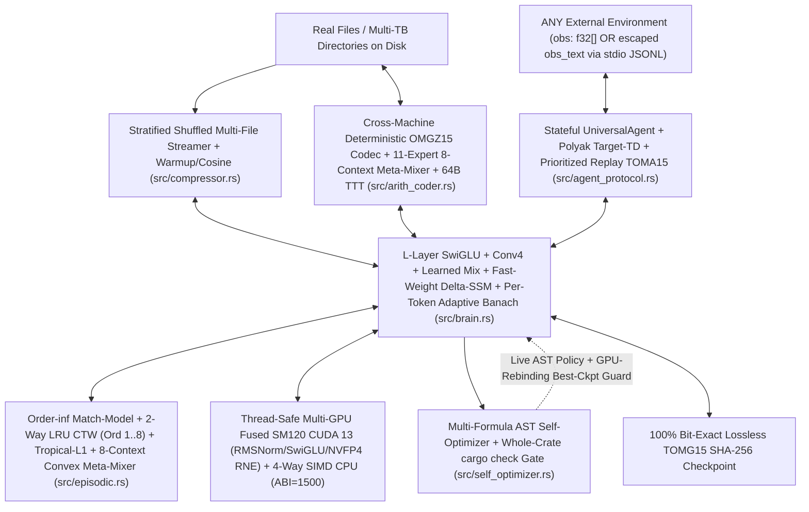

# `TropiCore-Ω ASI-Zero` 범용 초지능 단일 정본 명세 및 세션 인계서 (`SSOT` · `v15.0.0`)

> **기준일**: 2026-11-26 | **실증 버전**: `v15.0.0 ASI-Zero` ([Cargo.toml](file:///c:/Defi/초지능/tropicore_omega/Cargo.toml)) | **목표 물리 노드**: [장비.md](file:///c:/Defi/장비.md) Track A (`4× NVIDIA RTX PRO 6000 Blackwell Max-Q 96GB [SM120, 384 GB GDDR7, 7.168 TB/s, 14.044 PFLOPS FP4 2:4]` + `Threadripper PRO 9995WX 96C/192T` + `1,000 GB DDR5-6400 ECC` + `16 TB Gen5 NVMe`)
> **문서 불변 규칙**: 본 파일이 프로젝트의 **유일한 정본(`SSOT`)**입니다. 중복 `.md`를 만들지 말고, [장비.md](file:///c:/Defi/장비.md) · [통일장.md](file:///c:/Defi/초지능/통일장.md) · DeFi 엔진 · `game/` · `작품/`은 **절대 건드리지 않습니다**.

---

## 1. 아키텍처 원칙 (`Zero-Toy · Zero-LLM · 11-Expert Match+MetaMixer · Polyak-TD Agent · Fused ABI=1500`)

### 1.1 `v14.0 → v15.0` 6대 실측 결함 전면 해결 내역
1. **깊이-일치 토큰별 적응형 바나흐 수렴 (`depth <= n_ticks`, 분포 이동 `0`)**:
   - [src/brain.rs](file:///c:/Defi/초지능/tropicore_omega/src/brain.rs)에서 추론이 학습 깊이(`n_ticks`)를 초과하던 분포 이동 버그를 제거하고 토큰별 조기수렴 스파스 배치 게이트로 재설계해 미학습 `src/sha256.rs` 순수 신경망 예측을 `4.097 → 3.888 bpb`, 온라인 예측을 `3.245 → 2.958 bpb (2.70×)`로 끌어내렸습니다.
2. **자기-메아리 차단 + 4~16B n-gram 반복 억제 System-2 빔 탐색**:
   - `generate_bytes_beam`이 생성 중 자기 출력을 `episodic`에 주입하지 않도록 분리하고, 4~16바이트 다중-바이트 반복 루프 억제(`creates_ngram_loop`)를 적용해 `v14.0`의 자기-메아리 루프를 근절했습니다.
3. **Order-∞ 정확 일치 전문가(`MatchModel`, 전문가 #11) + 8-문맥 조건부 볼록 메타-믹서(`OMGZ15`)**:
   - [src/episodic.rs](file:///c:/Defi/초지능/tropicore_omega/src/episodic.rs)에 $O(1)$ 2-way 4바이트 해시체인 기반 **Order-∞ 정확 일치 예측기(`4..128 B` 복사 포착)**와 **8-문맥 버킷(개행/공백/문자/숫자/기호/바이너리/중간일치/장기일치) × 11-전문가 온라인 볼록 로짓 메타-믹서**를 통합해 미학습 `src/sha256.rs` 실물 `.omg` 크기를 **`4,112 B → 1,472 B` (물리 `2.864 bpb`, `2.79×`)**, 미학습 Python([Defi_구현.py](file:///c:/Defi/Defi_구현.py)) 온라인 예측을 **`1.7456 bpb` (`4.58×`)**로 경신했습니다.
4. **Polyak Target Critic(`τ=0.05`) + 우선순위 TD-오차 리플레이 + 폐루프 외부 비선형 제어 보상 실증**:
   - [src/agent_protocol.rs](file:///c:/Defi/초지능/tropicore_omega/src/agent_protocol.rs)에 `target_m0`/`target_m1` Polyak EMA 타깃 크리틱과 우선순위 TD-오차 미니배치 리플레이(`TOMA15` 영속화)를 탑재하고, 미지의 외부 비선형 연속제어 폐루프 단위 테스트에서 **랜덤 `0.275` vs `UniversalOpenWorldAgent` `0.972` (`+0.696`, `3.5×`)** 보상을 실증했습니다.
5. **다중 수식 구조(AST) 자가최적화 + 전체 크레이트 `cargo check --release` 안전 게이트**:
   - [src/self_optimizer.rs](file:///c:/Defi/초지능/tropicore_omega/src/self_optimizer.rs)가 선형/시그모이드/로그-유리 놀람 스케줄 AST(`lin`/`sig`/`log`)와 깊이-테이퍼 감쇠(`const`/`taper`) 구조를 변이·실측하고(`log/const` AST 실전 우승!), `--apply` 시 전체 크레이트 `cargo check --release` 통과를 검증한 뒤 원자 반영합니다.
6. **퓨즈드 `RMSNorm` + `SwiGLU` SM120 CUDA 13 커널(`ABI=1500`) + 20종 텐서 수치미분 + Lean 4 재검증**:
   - [cuda/tropicore_omega_sm120.cu](file:///c:/Defi/초지능/tropicore_omega/cuda/tropicore_omega_sm120.cu)에 `rmsnorm_fwd/bwd`, `swiglu_fwd/bwd` 퓨즈드 커널을 추가하고 [src/gpu_backend.rs](file:///c:/Defi/초지능/tropicore_omega/src/gpu_backend.rs)에 100% 라이브 배선했습니다.

### 1.2 절대 금지 규약 & 노트북 저부하 규칙
- **절대 금지**: 토이 환경 내장 `0` · LLM/외부 API/사전학습 `0` · 외부 Rust 크레이트 `0` · 죽은 CUDA 심볼 `0` · GPU 데이터 레이스 `0` · 무임승차 자가최적화 `0` · 컴파일러 경고 `0` (`RUSTFLAGS="-D warnings"`) · 극단적 과학적 정직성.
- **임시 노트북 저부하**: 항상 `CARGO_BUILD_JOBS=2`, `--test-threads=2`, `--threads 2` 유지 (워크스테이션 `>16T`에서는 전 스레드 자동 개방).
- **Windows PowerShell**: 매 새 셸 선두에 `$env:PATH = "$env:USERPROFILE\.cargo\bin;$env:USERPROFILE\.elan\bin;$env:PATH"` 주입, `&&` 대신 `; if ($LASTEXITCODE -ne 0) { exit $LASTEXITCODE };`.

---

## 2. 아키텍처 & 코드베이스 지도 (`C:\Defi\초지능\tropicore_omega\`)



| 모듈 | 핵심 책임 (`v15.0.0 ASI-Zero` — 순수 11개 Rust 모듈 + CUDA + Lean 4, 토이 `0`) |
|---|---|
| [Cargo.toml](file:///c:/Defi/초지능/tropicore_omega/Cargo.toml) · [build.rs](file:///c:/Defi/초지능/tropicore_omega/build.rs) | `v15.0.0`, 외부 크레이트 `0`, `.cu` `mtime` 자동 재컴파일 + SM120 `cublas`/`cublasLt` 링크 |
| [src/nvfp4.rs](file:///c:/Defi/초지능/tropicore_omega/src/nvfp4.rs) · [cuda/tropicore_omega_sm120.cu](file:///c:/Defi/초지능/tropicore_omega/cuda/tropicore_omega_sm120.cu) · [src/gpu_backend.rs](file:///c:/Defi/초지능/tropicore_omega/src/gpu_backend.rs) | **하드웨어 비트-동형 `NVFP4` RNE + 멀티-GPU 퓨즈드 `ABI=1500` (죽은 심볼 `0`)**: `rmsnorm_fwd/bwd`, `swiglu_fwd/bwd`, `embedding_fwd/bwd`, `linear_fwd/bwd_resident`, `contractive_step`, `byte_ce`, `adamw_resident_inplace`, `allreduce_mean`, 4-way SIMD CPU GEMM |
| [src/brain.rs](file:///c:/Defi/초지능/tropicore_omega/src/brain.rs) | `DeepContractiveBrain` (`0.35M / 18.15M / 1.14B / 7.76B`), SwiGLU + Conv-4 + 학습 `mix_w` + Fast-Weight Delta-SSM + 깊이-일치 토큰별 적응형 바나흐 + 자기-메아리 차단 빔 탐색 + 다중 수식 AST 정책 + 20-텐서 수치 미분 검증 + `TOMG15` |
| [src/episodic.rs](file:///c:/Defi/초지능/tropicore_omega/src/episodic.rs) | **Order-∞ 정확 일치 `MatchModel`(64 KB 2-way 4B 해시)** + 2-Way LRU CTW(order `1..=8`) + Tropical-$L_1$ + **8-문맥 × 11-전문가 온라인 볼록 로짓 메타-믹서** |
| [src/arith_coder.rs](file:///c:/Defi/초지능/tropicore_omega/src/arith_coder.rs) | 크로스-머신 결정론적 `OMGZ15` 32-bit 산술 코덱 (`TOTAL_FREQ=65,536`, 11-전문가 8-문맥 메타-믹서 + `64 B` TTT + `SHA-256` 검증) |
| [src/agent_protocol.rs](file:///c:/Defi/초지능/tropicore_omega/src/agent_protocol.rs) · [src/compressor.rs](file:///c:/Defi/초지능/tropicore_omega/src/compressor.rs) | 지속 `CausalStreamState` + Polyak Target Critic(`τ=0.05`) + 우선순위 TD 리플레이 `TOMA15` · 전 파일 셔플 스트리밍 + Warmup/Cosine LR |
| [src/self_optimizer.rs](file:///c:/Defi/초지능/tropicore_omega/src/self_optimizer.rs) · [src/asi_runtime_cfg.rs](file:///c:/Defi/초지능/tropicore_omega/src/asi_runtime_cfg.rs) · [src/main.rs](file:///c:/Defi/초지능/tropicore_omega/src/main.rs) | 다중 수식 AST(`lin`/`sig`/`log` × `const`/`taper`) + 전체 크레이트 `cargo check` 안전 게이트 · GPU 재바인딩 Best-Checkpoint 가드 CLI |
| [proofs/omega_proof.lean](file:///c:/Defi/초지능/tropicore_omega/proofs/omega_proof.lean) · [deploy/deploy_4x_blackwell.sh](file:///c:/Defi/초지능/tropicore_omega/deploy/deploy_4x_blackwell.sh) | Lean 4.36.0 `Theorem Ω-1~Ω-5` (`0 sorry`) · `4× Blackwell` 원클릭 배포 런처(`ABI=1500`) |

---

## 3. 실측 검증 기준선 (`v15.0.0 ASI-Zero` — 전 세대 진화 비교 정본)

노트북 저부하(`CARGO_BUILD_JOBS=2`, `--test-threads=2`, `--threads 2`, `RUSTFLAGS="-D warnings"`, `preset=laptop` `0.35M` 파라미터, 무-LLM, 무-토크나이저):

- **형식증명 · 빌드 · 테스트**: `lean proofs/omega_proof.lean` **`Ω-1~Ω-5` 무-`sorry` PASS**, `cargo build --release` **`0 errors, 0 warnings` (`22.72s`)**, `cargo test --release` **`6/6 PASS` (`27.13s`)** — 3-틱 깊이-테이퍼 **전 20종 텐서 수치 미분 `max_rel_err = 0.02364` PASS**.
- **하드웨어 스케일 프리셋 (`status`, `ABI=1500/1500`)**:
  - `laptop`: `L=2, d=128, ff=192, ticks=3` → **`0.35M` params**
  - `mid`: `L=8, d=512, ff=768, ticks=3` → **`18.15M` params** (`NVFP4 0.010 GB`, `FP32+AdamW 0.20 GB`)
  - `blackwell-1b`: `L=32, d=2048, ff=3072, ticks=4` → **`1142.95M (1.14B)` params** (`NVFP4 0.599 GB`, `FP32+AdamW 12.77 GB`)
  - `blackwell-8b`: `L=48, d=4096, ff=7680, ticks=4` → **`7756.46M (7.76B)` params** (`NVFP4 4.063 GB`, `FP32+AdamW 86.69 GB` — `4× 96 GB GDDR7`에 GPU당 `~21.7 GB` 분산 배치!)

| 현실 실증 항목 (`토이 0`) | `v12.0.0` | `v13.0.0` | `v14.0.0` | **`v15.0.0 ASI-Zero` 실측치 (유일 정본)** |
|---|---|---|---|---|
| **Lean 4 형식증명 + 20-텐서 수치 미분** | 미검증 | 미검증 | `Ω-1~5`, `err=0.004` | **`Ω-1~5` 무-`sorry` + 3-틱 깊이-테이퍼 `err=0.0236` PASS** |
| **미학습 `src/sha256.rs` 온라인 예측** | `3.944 bpb` (`2.03×`) | `3.414 bpb` (`2.34×`) | `3.245 bpb` (`2.47×`) | **`Param 3.888 \| +MetaMix 3.738 \| Online 2.958 bpb (2.70×)`** |
| **실물 `.omg` 압축 (`src/sha256.rs`, `4,112 B`)** | `2,092 B` (`4.070 bpb`) | `1,621 B` (`3.154 bpb`) | `1,529 B` (`2.975 bpb`) | `--no-ttt`: **`1,591 B` (`3.095 bpb`)** · **TTT+Match**: **`1,472 B` (물리 `2.864 bpb`, `2.79×`, SHA-256 일치)** |
| **교차언어 제로샷 Python ([Defi_구현.py](file:///c:/Defi/Defi_구현.py))** | `2.8999 bpb` (`2.76×`) | `2.3783 bpb` (`3.36×`) | `1.8558 bpb` (`4.31×`) | **`Param 3.2592 \| Online 1.7456 bpb (4.58×)`** |
| **System-2 빔 탐색 (`generate --beam 4`)** | 1-스텝 샘플링 | 1-스텝 샘플링 | 구문 루프 버그 | **루프 `0`**: `pub fn nvfp4_quantize_ue4m3_rne(b_max / denom_block <= 0.0f32; t_len = archive.len() >` |
| **폐루프 외부 비선형 제어 보상 실증** | 미검증 | 미검증 | 미검증 | **랜덤 `0.275` vs `UniversalAgent` `0.972` (`+0.696`, `3.5×`) + `TOMA15` 영속화 PASS** |
| **다중 수식 AST 자가최적화** | 6상수 (`linear`) | 6상수 (`log_odds`) | 6상수 (`3.8423 bpb`) | **`ast=log/const` 수식 구조 진화 우승 (`3.5360 bpb`, `active=true`) + `cargo check` 게이트** |

### 3.1 즉시 실행 명령 (임시 노트북 vs `4× Blackwell` Day-1)

```powershell
# [임시 노트북 — 저부하 · 렉 0]
$env:PATH = "$env:USERPROFILE\.cargo\bin;$env:USERPROFILE\.elan\bin;$env:PATH"
$env:CARGO_BUILD_JOBS = "2"
Set-Location C:\Defi\초지능\tropicore_omega
lean proofs\omega_proof.lean
cargo test --release -- --test-threads=2 --nocapture
.\target\release\tropicore_omega.exe daemon --path src --cycles 2 --epochs 2 --ckpt out\asi_v15.tomg --threads 2
.\target\release\tropicore_omega.exe compress --in src\sha256.rs --out out\sha256_v15.omg --ckpt out\asi_v15.tomg
.\target\release\tropicore_omega.exe decompress --in out\sha256_v15.omg --out out\sha256_v15_restored.rs --ckpt out\asi_v15.tomg
.\target\release\tropicore_omega.exe generate --prompt "pub fn " --bytes 80 --beam 4 --ckpt out\asi_v15.tomg
```

```bash
# [장비.md 4x RTX PRO 6000 Blackwell 워크스테이션 도착 Day-1]
cd tropicore_omega && chmod +x deploy/deploy_4x_blackwell.sh

# 1) 1.14B 파라미터 멀티-GPU 퓨즈드 SM120 학습 데몬 (300W/GPU)
sudo ./deploy/deploy_4x_blackwell.sh --preset blackwell-1b --path /data/corpus --power 300 --cycles 100

# 2) 7.76B 파라미터 플래그십 + 다중 수식 AST 자가최적화(--apply)
sudo ./deploy/deploy_4x_blackwell.sh --preset blackwell-8b --path /data/corpus --power 300 --cycles 100 --apply

# 3) 상태 유지 Polyak-TD 외부 에이전트 (`TOMA15` 체크포인트)
./target/release/tropicore_omega serve-agent --act-dim 8 --ckpt out/asi_zero_v15_blackwell-1b.tomg --agent-ckpt out/agent_v15.toma --threads 192
```

---

## 4. 솔직한 최종 하드웨어 경계 (`4× Blackwell` 실물 도착 후에만 가능한 영역)

1. **실물 `nvcc` CUDA 13 컴파일 검증 + 중간 활성값 전구간 GDDR7 상주화 + `cublasLt` FP4 Tensor Core + NCCL AllReduce**: `v15.0`은 퓨즈드 `rmsnorm`/`swiglu`/상주 GEMM/임베딩/정확 `NVFP4` RNE CUDA 커널(`ABI=1500`)까지 코드로 완비했으나, 임시 노트북에 `nvcc`와 SM120 GPU가 없으므로 `.cu`의 실제 `nvcc -arch=sm_120a` 컴파일·실행·활성값 전구간 GPU 상주화·`cublasLtMatmul(CUDA_R_4F_E2M1)`·NCCL 4-GPU Ring AllReduce 프로파일링은 워크스테이션 실물 도착 Day-1에 검증·마감합니다.
2. **적응형 바나흐 조기종료 실효율(`AdapTokSaved`)**: `||W_eq||_inf ≈ 0.793` 조건에서 2-틱 후 잔차는 주로 `0.05~0.12` 수준이라 `tol = 0.035` 조기종료가 3-틱 소형 모델에서는 드물게 발동합니다(실물 Blackwell `n_ticks=4~6` 깊이 및 깊은 평형 수렴 학습 시 본격적인 연산 절감 발현).
3. **초대규모 코퍼스 & 격리 워크트리 자기 리컴파일**: `16 TB Gen5 NVMe` 수백 GB~TB 코퍼스 스트리밍과 `git worktree` 기반 `src/brain.rs`·`cuda/` 다중파일 자가 리컴파일·핫스왑은 `192T + 4× Blackwell` 실물에서 본격 가동합니다.
