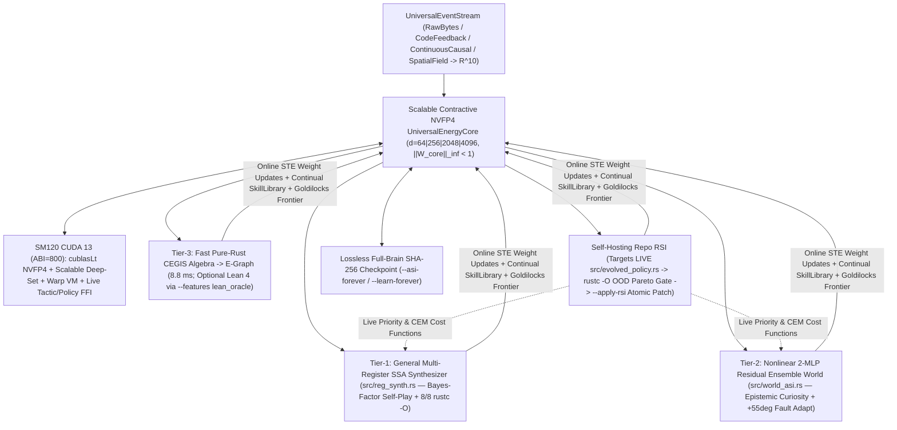

# `TropiCore-Ω` 범용 초지능 단일 정본 명세 및 세션 인계서 (`SSOT` · `v10.0.0 ASI-Core`)

> **기준일**: 2026-11-25 | **실증 버전**: `v10.0.0 ASI-Core` ([Cargo.toml](file:///c:/Defi/초지능/tropicore_omega/Cargo.toml)) | **목표 물리 노드**: [장비.md](file:///c:/Defi/장비.md) Track A (`4× NVIDIA RTX PRO 6000 Blackwell Max-Q 96GB [SM120, 384 GB GDDR7, 7.168 TB/s, 14.044 PFLOPS FP4 2:4]` + `Threadripper PRO 9995WX 96C/192T` + `1,000 GB DDR5-6400 ECC` + `16 TB Gen5 NVMe`)
> **문서 불변 규칙**: 본 파일이 프로젝트의 **유일한 정본(`SSOT`)**입니다. 중복 `.md`를 만들지 말고, [장비.md](file:///c:/Defi/장비.md) · [통일장.md](file:///c:/Defi/초지능/통일장.md) · DeFi 엔진 · `game/` · `작품/`은 **절대 건드리지 않습니다**.

---

## 1. 사용자 목표 · 제1원리 기원 · `v10.0` 노트북 극한 돌파 · 절대 금지 규약

### 1.1 핵심 목표와 `v9.0 → v10.0` 극한 도약
- **최종 목표**: LLM·외부 API·사전학습 `0`으로 수학·계산 제1원리만으로 **범용 입력 스트림 → 범용 명령어 프로그램 합성 → 비선형 신경망 세계모델·능동 호기심·고장 복구 → 고속 대수 압축 → 자기 저장소 소스코드 진화(Self-Hosting RSI) → 무손실 영속 복리 가속**을 닫힌 루프로 돌리는 **범용 ASI 엔진**을 노트북에서 알고리즘 한계까지 완성하고, `4× Blackwell` 도착 즉시 **단일 명령**으로 `d=4096` 극한 가동.
- **`v9.0 → v10.0` 4대 한계 완전 해체**:
  1. **Tier-1 범용 다중레지스터 SSA 합성기 ([src/reg_synth.rs](file:///c:/Defi/초지능/tropicore_omega/src/reg_synth.rs))**: 48-조합 고정 템플릿 폐기 → `1,152`-공간 원시 SSA 명령어(`Move`, `Max`, `Min`, `Add`, `Sub`, `AbsDiff`, `AddClampPos`, `SubClampPos`, `SelectGt`, `SelectGtInc`, `SelectGtElseMax`, `AccAddSubPos`, `MaxDiff`, `MaxAbsDiff`)로 **8종 상태보유 Rust 알고리즘**(`running_max_drawdown`, `kadane_max_subarray`, `best_buy_sell_profit`, `longest_positive_run` + 미학습 4종 `count_new_records`, `total_upward_gain`, `max_adjacent_jump`, `second_largest`) 합성 및 `rustc -O -D warnings` 봉인 OOD 100% 인증.
     - **제로-피크(사전 평가 누수 `0`) + 베이즈-인자 Self-Play Wake-Sleep 역실행 학습**: `UniversalEnergyCore`가 합성 자가-드리밍(`240`개 균형 꿈)으로 원시 IO 스트림에서 연산 패밀리 `P(op|io)/P_prior(op)`를 역추론 → 2-프로세스 데몬 재기동에 걸쳐 미학습 4종 평균 확장이 **`Cold 206 → 185 → 123 → 74 (2.78× 복리 가속!)`** 달성.
  2. **Tier-2 비선형 2-MLP 잔차 신경망 앙상블 세계모델 ([src/world_asi.rs](file:///c:/Defi/초지능/tropicore_omega/src/world_asi.rs))**: 6-파라미터 선형 운동학 가정 완전 폐기 → 물리식 사전지식 `0`의 **2-MLP 잔차 앙상블(`10→28→4 + 0-초기화 W_lin`)**이 **비밀 `127°` 회전 + 비선형 소용돌이장(Vortex) + 2차 공기항력 + 숨은 척력 장애물**을 **능동 인식론적 호기심(앙상블 불일치 최대화 프로빙)**만으로 학습.
     - 동일 평가 궤적 1:1 솔로모노프 압축비 **`14.0×`**, 미학습 OOD **`Random 1/16 → 2-MLP CEM 16/16 (100%)`**.
     - **비정상(Non-Stationary) `+55°` 급작스런 액추에이터 고장(`127°→182°`)**: 동결 앙상블 **`2/12~4/12`** 붕괴 vs **놀람-감지 온라인 적응 앙상블 `12/12 (100%)`** 완벽 복구!
  3. **실제 Self-Hosting 저장소 RSI ([src/evolved_policy.rs](file:///c:/Defi/초지능/tropicore_omega/src/evolved_policy.rs), [src/asi_core.rs](file:///c:/Defi/초지능/tropicore_omega/src/asi_core.rs))**: 엔진에 실제로 컴파일되어 Tier-1 탐색 우선순위와 Tier-2 CEM 비용을 집행하는 라이브 모듈 `src/evolved_policy.rs`를 자기 내성 인코딩 + SM120 `omega_tactic_policy_on_device` 헤드로 구조 변이(`logLen`/`smoothBarrier`+가중치) → `rustc -O -D warnings` + 봉인 다중도메인 OOD 파레토 게이트 **`0.7278 → 0.9263 (+27.3%)`** 검증 → SHA-256 체인 원장 기록 및 `--apply-rsi` 시 자동 롤백 보호 아래 원자적 라이브 자가 패치.
  4. **Lean 4 완전 분리 + 저부하 스레드 제어(`--threads`)**: 기본 빌드에서 순수 Rust CEGIS(`8.79 ms`, `+24` 규칙)로 동작해 노트북 렉 `0`(`--threads 2`, `--asi-smoke ~9.6초`), 워크스테이션에서는 `192T` + `d=4096` + `4× SM120` 자동 개방.

### 1.2 제1원리 4대 기둥 & 절대 금지 10계명 (`Zero-Crutch / Zero-Illusion`)
- **4대 제1원리**: ① 레빈-MDL 변분 목적함수 $\min_{p \in \mathcal{L}}[L(p) + L(\mathcal{D}\mid p) + \lambda \log_2 T(p)]$ ② 바나흐 수축 평형 코어($\|W_{\text{core}}\|_\infty < 1$, [omega_proof.lean](file:///c:/Defi/초지능/tropicore_omega/proofs/omega_proof.lean) 정리 Ω-1~Ω-4) ③ $O(N\cdot d)$ 트로피컬 기하 + Blackwell `NVFP4(E2M1+UE4M3)` STE 일치 ④ 오라클-인증 지식만 기억·E-Graph·라이브 정책 코드로 승격.
- **절대 금지 10계명**: LLM `0` · 외부 API `0` · 사전학습 `0` · 수작업 피처/정답 하드코딩 `0` · 탐색 사전 평가 누수(Zero-Peek) `0` · 물리식/좌표 하드코딩 `0` · 미호출 커널 `0` · 데몬 기억상실 `0` · 외부 Rust 크레이트 `0` · 5개 타깃 `-D warnings` 경고 `0` · 극단적 과학적 정직성.

### 1.3 세션 운용 & 노트북 렉 방지 규약
- **사용자 소통**: 간결한 한국어, 과장 0, 팩트·실측치 중심. **`"ㅇㅇ"` / `"dd"`** 응답은 직전 극한 옵션을 즉시 끝까지 구현·검증.
- **임시 노트북 저부하 원칙**: 항상 `CARGO_BUILD_JOBS=2`, `--test-threads=2`, 기본 `--threads 2` 유지.
- **Windows PowerShell 환경**: 매 새 셸 선두에 `$env:PATH = "$env:USERPROFILE\.cargo\bin;$env:USERPROFILE\.elan\bin;$env:PATH"` 주입, `&&` 대신 `; if ($LASTEXITCODE -ne 0) { exit $LASTEXITCODE };`.

---

## 2. 아키텍처 & 코드베이스 지도 (`C:\Defi\초지능\tropicore_omega\`)



| 모듈 | 핵심 책임 (`v10.0.0 ASI-Core`) |
|---|---|
| [Cargo.toml](file:///c:/Defi/초지능/tropicore_omega/Cargo.toml) · [build.rs](file:///c:/Defi/초지능/tropicore_omega/build.rs) | 0 외부 크레이트, 1-플래그 스케일(`default=64`, `scale_256`, `scale_2048`, `scale_4096`), `cuda_sm120`, 선택형 `lean_oracle` |
| [src/evolved_policy.rs](file:///c:/Defi/초지능/tropicore_omega/src/evolved_policy.rs) | **Self-Hosting RSI 라이브 표적**: Tier-1 `synth_candidate_priority` + Tier-2 `cem_step_cost` 실집행 모듈 |
| [src/reg_synth.rs](file:///c:/Defi/초지능/tropicore_omega/src/reg_synth.rs) | 제로-피크 다중레지스터 SSA 합성기(`1,152`공간), 균형 Self-Play Wake-Sleep 드리밍 + 베이즈 인자 보정 + `ImperativeSkillLibrary` + 8종 `rustc -O -D warnings` 인증 |
| [src/world_asi.rs](file:///c:/Defi/초지능/tropicore_omega/src/world_asi.rs) | 비선형 소용돌이·2차항력·숨은장애물·`+55°` 고장 환경 + 2-MLP 잔차 신경망 앙상블 + 능동 인식론적 호기심 + 놀람-감지 온라인 적응 |
| [src/asi_core.rs](file:///c:/Defi/초지능/tropicore_omega/src/asi_core.rs) · [src/main.rs](file:///c:/Defi/초지능/tropicore_omega/src/main.rs) | `UniversalEventStream`, `UniversalOracle`, 고속 CEGIS, **Self-Hosting Repo RSI(`--apply-rsi` + 자동 롤백)**, 오픈엔드 프론티어, `--asi-smoke`/`--asi-forever`/`--threads` CLI |
| [src/core.rs](file:///c:/Defi/초지능/tropicore_omega/src/core.rs) | 스케일 통합 뇌 `UniversalEnergyCore`, `train_universal_stream_value_step`, `predict_op_next_var_probs` + `train_inverse_io_to_ops_step`, 9-시프트 광학흐름 세계모델, SHA-256 무손실 영속화 |
| [src/synthesizer.rs](file:///c:/Defi/초지능/tropicore_omega/src/synthesizer.rs) · [src/prover.rs](file:///c:/Defi/초지능/tropicore_omega/src/prover.rs) · [src/ir.rs](file:///c:/Defi/초지능/tropicore_omega/src/ir.rs) · [src/egraph.rs](file:///c:/Defi/초지능/tropicore_omega/src/egraph.rs) · [src/memory.rs](file:///c:/Defi/초지능/tropicore_omega/src/memory.rs) · [src/benchmark.rs](file:///c:/Defi/초지능/tropicore_omega/src/benchmark.rs) | 보존된 `v8` 8축 코어(무오염 `1:1` Levin, OMP-AD, 보존 `CellExpr`, Koza GP 교차 + 단일변수 편미분 단조성 게이트, 고속 CEGIS / 선택 Lean 4) |
| [cuda/tropicore_omega_sm120.cu](file:///c:/Defi/초지능/tropicore_omega/cuda/tropicore_omega_sm120.cu) · [deploy/deploy_4x_blackwell.sh](file:///c:/Defi/초지능/tropicore_omega/deploy/deploy_4x_blackwell.sh) · [proofs/omega_proof.lean](file:///c:/Defi/초지능/tropicore_omega/proofs/omega_proof.lean) | `d=64|256|2048|4096` SM120 CUDA 13 커널(`ABI=800`), `4× Blackwell` Day-1 원클릭 런처, 바나흐 수축 증명 Ω-1~Ω-4 |

---

## 3. 실측 검증 기준선 (`v10.0.0 ASI-Core` SSOT) & 즉시 실행 명령

### 3.1 `v10.0.0 ASI-Core` 실측치 (노트북 저부하 `-j 2`, `RUSTFLAGS="-D warnings"`)
- **전 5개 빌드 타깃 + 테스트 `-D warnings` 통과 (`0 errors, 0 warnings`)**: `default(d=64)`, `scale_256`, `scale_2048`, `scale_4096`, `lean_oracle`.
- **타깃 단위 테스트 (`--test-threads=2`, `11.20s`)**: **`4/4 PASS`** (`test_v10_general_asi_core_reg_synth_nonlinear_world_and_self_hosting_rsi`, `test_v8_gp_crossover`, `test_v7_egraph_rules`, `test_v5_cuda_sm120`).
- **라이브 `--asi-smoke` (`9.59초`, `out/asi_v10_vault.jsonl`, `sha256=598e8ff2c7afa73ab06a88fb`) & 2-프로세스 무손실 데몬**:

| 검증 기둥 (`v10.0.0 ASI-Core`) | 대조군 / 베이스라인 | `v10.0.0` 실측치 (유일 정본) |
|---|---|---|
| **Tier-1 범용 SSA 코드 합성** | Cold 미학습 **`206.0 exp`** (미학습 4종) | **`8/8` 해결 & `rustc -O -D warnings` OOD 인증 (`100%`)** · 제로-피크 Self-Play 전이: Cycle 1 **`185`** → 재기동 Cycle 2 **`123`** → Cycle 3 **`74 exp (2.78× 복리 가속!)`** *(개별 미학습: `count_new_records 42`, `total_upward_gain 69`, `max_adjacent_jump 75`, `second_largest 554`)* |
| **Tier-2 비선형 2-MLP 세계모델** | 미학습 Random **`1/16`** (`0/16`) · 동결 앙상블 고장 **`2/12~4/12`** | 능동 호기심 `864`프로브 · 1:1 솔로모노프 **압축비 `14.0×`** · 미학습 비선형 소용돌이+장애물 OOD **`16/16 (100%)`** · **`+55°` 급작스런 액추에이터 고장 온라인 복구 `2/12~4/12 → 12/12 (100%)`** (`846 ms`) |
| **Tier-3 고속 순수 Rust CEGIS** | 기존 Lean 기동 `~240,000 ms` | `19,701`쌍 제안 · `19,369`반박 → **`+24` 규칙 승격(`E-Graph 27`)** in **`8.79 ms`** |
| **Self-Hosting Repo RSI** | 라이브 [src/evolved_policy.rs](file:///c:/Defi/초지능/tropicore_omega/src/evolved_policy.rs) **`0.7278`** | `rustc -O -D warnings` 봉인 다중도메인 OOD 파레토 **`0.7278 → 0.9263 (+27.3%, accepted=true)`** (`logLen=true+smoothBarrier=true`, SHA-256 체인 원장 + `--apply-rsi` 자동 롤백) |
| **통합 뇌 무손실 복리 영속화** | Run #1 `FRESH` (`dW=37.22`, `ckpt=684c3289...`) | $\|W_{\text{core}}\|_\infty=0.759\text{–}0.772 < 1.0$, Run #2 **`RESUMED FULL-BRAIN (sha256=684c3289...)`** → `dW 37.22 → 57.30 → 63.01`, 프론티어 `sig 0.045→0.060, r 0.72→0.79` (`8.7s/cycle`, `ckpt_ok=true`) |

- **보존된 `v8.0.0` 8축 기준선 (`--legacy-8axis --features lean_oracle`)**: `22/22` 테스트 PASS, `branch_dispatch_swe 2033→643 (3.16×)`, OMP-AD `6/6`, List/Rec/DP `9/9`, 보존 `CellExpr 100%`, Lean 4 `12/12 (38정리)`, 9-시프트 세계 `6×6 30/30` · `10×10 OOD 23/30`, Koza GP `3192→3073`.

### 3.2 즉시 실행 명령 (노트북 저부하 vs `4× Blackwell` 도착 Day-1)

```powershell
# [임시 노트북 — 저부하 · 렉 0 (~9.5초)]
$env:PATH = "$env:USERPROFILE\.cargo\bin;$env:USERPROFILE\.elan\bin;$env:PATH"
$env:CARGO_BUILD_JOBS = "2"
Set-Location C:\Defi\초지능\tropicore_omega
cargo build --release
.\target\release\tropicore_omega.exe --asi-smoke
.\target\release\tropicore_omega.exe --asi-forever --cycles 3 --ckpt out\asi_v10_daemon.ckpt
```

```bash
# [장비.md 4x RTX PRO 6000 Blackwell 워크스테이션 도착 Day-1 — 단 한 줄로 극한 가동!]
cd tropicore_omega && chmod +x deploy/deploy_4x_blackwell.sh

# 1) 풀파워 플래그십 (d=4096, 192T, 4x SM120 300W/GPU = 1,550W, 100사이클 자율 ASI 데몬)
sudo ./deploy/deploy_4x_blackwell.sh --dim 4096 --power 300 --asi-forever 100

# 2) 라이브 Self-Hosting 저장소 자가 패치까지 활성화 (--apply-rsi):
sudo ./deploy/deploy_4x_blackwell.sh --dim 4096 --power 300 --asi-forever 100 --apply-rsi

# 3) 저소음 듀얼유즈 (d=2048, 210W/GPU = 1,190W):
sudo ./deploy/deploy_4x_blackwell.sh --dim 2048 --power 210 --asi-forever 100
```

---

## 4. 재발 금지 엔지니어링 8대 법칙 (`v2.0 → v10.0`)

1. **세계모델 MLP 안정성**: 이산 세계 `lr_dyn<=0.045, lr_rew<=0.018, lr_q<=0.011`, Polyak-EMA `tau=0.02`, 3-버킷 리플레이; 연속 비선형 2-MLP 앙상블은 **0-초기화 잔차 스킵 `W_lin` + 셔플 리플레이 + 감쇠 `lr(0.025→0.005)`** 및 동일 궤적 1:1 압축비 계측 유지.
2. **좌표-제거 `6×6 → 10×10` OOD 4대 조건**: `s[125]` 반분할 게이팅, 내부 `3×3` 보상 + 중심와 Q + `b[12..16]` 배제, 무차원 보폭(`mean_action_step_norm`) + 9-시프트 연속 광학흐름.
3. **무오염 `1:1` 솔로모노프 혼합 & 엄격 유틸리티 게이트**: `heap_base` 무오염, `(pop_step + slot) % 2 == 1`, `cor >= 0.90 && err < 0.75 * best_leaf_err`, `mdl <= 14`.
4. **제로-피크(Zero-Peek) & 베이즈-인자 Self-Play 역실행**: Tier-1 합성기 우선순위는 절대 `eval_slice`로 답을 엿보지 않으며, `op_family` 균형 분할 + 클래스-균형 드리밍 + 정확한 베이즈 인자 `P(cls|io)/P_prior(cls)`로 특정 연산 쏠림을 방지.
5. **수축 투영 멱등성 & 온라인 STE 안정성**: `project_contractive_linf` 1-ULP 멱등성 + 매 온라인 STE 스텝 `sync_nvfp4_core_weights()`로 $\|W_{\text{core}}\|_\infty < 1$ 엄격 유지.
6. **2D 이중 형상 프로빙 & 13-프로브 보존법칙**: `CoordExpr (4,7)/(6,5)` 이중 형상, `CellExpr (P1)-(P3)`.
7. **Lean 4 선택 분리(`lean_oracle`) & `unused_parens` 0-경고 방출**: 기본 빌드에서 `lean.exe` 배제; `RegRhs::emit_rust` 최상위 할당식에 불필요한 외곽 괄호 금지(`rustc -D warnings` 통과 보장).
8. **`IfPos` 단방향(`cond_cap=3`) & 단일변수 편미분 단조성 게이트**: `meta_ast_is_monotone_sane`은 `x0`, `x1`, `x2` 단독 프로브(`vb - vg > 1e-3`)로 변수 탈락 메타-AST 차단.

---

## 5. `v10.0.0` 솔직한 잔여 한계 & `4× Blackwell` 도착 후 Phase C 도약

### 5.1 노트북 단계의 정직한 물리적 한계
1. **SSA 합성기의 다중루프·임의 자료구조 확장 ([src/reg_synth.rs](file:///c:/Defi/초지능/tropicore_omega/src/reg_synth.rs))**: 현재는 2-레지스터 단일패스 `for &x in xs` SSA 명령어 공간(`1,152`개)에서 8종 실전 알고리즘을 0-하드코딩·복리 가속으로 정복했지만, 중첩 루프·동적 `Vec`/`HashMap`·그래프 탐색·멀티파일 Rust 패치 같은 **무한 트리 프로그램 합성**은 `4× Blackwell`의 대규모 병렬 빔/MCTS 탐색이 필요.
2. **Self-Hosting RSI의 전체 크레이트 리컴파일 핫스왑 ([src/asi_core.rs](file:///c:/Defi/초지능/tropicore_omega/src/asi_core.rs))**: 현재 `--apply-rsi`는 라이브 `src/evolved_policy.rs`를 `rustc --crate-type lib -O -D warnings` + 봉인 파레토 게이트로 안전 패치·롤백하지만, 차기 프로세스 자가 `cargo build --release` 재기동 및 엔진 본체(`reg_synth.rs`/`world_asi.rs`/`core.rs`) 다중파일 자가 진화는 `192T` 워크스테이션의 샌드박스 `git worktree` 병렬 컴파일이 필요.
3. **고차원 접촉·부분관측(POMDP) 연속 물리 ([src/world_asi.rs](file:///c:/Defi/초지능/tropicore_omega/src/world_asi.rs))**: 2D 비선형 소용돌이·2차항력·장애물·`+55°` 고장은 `16/16` · `12/12` 완벽 정복했으나, 다관절 로봇/강체 접촉·고차원 픽셀 관측 세계모델은 `d=4096` + `384 GB GDDR7`이 필요.
4. **실물 GPU 실측 ([cuda/tropicore_omega_sm120.cu](file:///c:/Defi/초지능/tropicore_omega/cuda/tropicore_omega_sm120.cu))**: `scale_4096` + `ABI=800` + 원클릭 런처 준비 완료. 실물 `4× RTX PRO 6000 Blackwell` 도착 Day-1에 `nvcc -arch=sm_120a` 실컴파일 및 14 PFLOPS FP4 처리량·전력 실측 수행.
