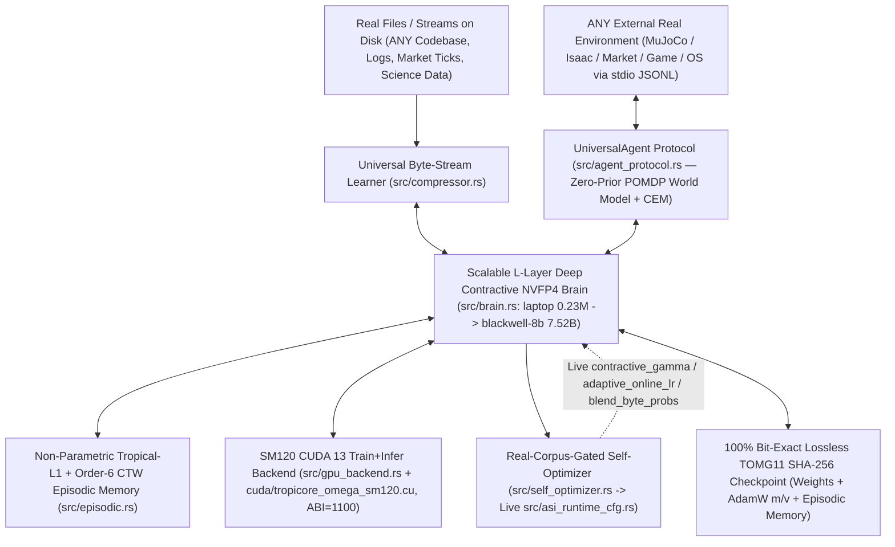

# `TropiCore-Ω ASI-Zero` 범용 초지능 단일 정본 명세 및 세션 인계서 (`SSOT` · `v11.0.0`)

> **기준일**: 2026-11-25 | **실증 버전**: `v11.0.0 ASI-Zero` ([Cargo.toml](file:///c:/Defi/초지능/tropicore_omega/Cargo.toml)) | **목표 물리 노드**: [장비.md](file:///c:/Defi/장비.md) Track A (`4× NVIDIA RTX PRO 6000 Blackwell Max-Q 96GB [SM120, 384 GB GDDR7, 7.168 TB/s, 14.044 PFLOPS FP4 2:4]` + `Threadripper PRO 9995WX 96C/192T` + `1,000 GB DDR5-6400 ECC` + `16 TB Gen5 NVMe`)
> **문서 불변 규칙**: 본 파일이 프로젝트의 **유일한 정본(`SSOT`)**입니다. 중복 `.md`를 만들지 말고, [장비.md](file:///c:/Defi/장비.md) · [통일장.md](file:///c:/Defi/초지능/통일장.md) · DeFi 엔진 · `game/` · `작품/`은 **절대 건드리지 않습니다**.

---

## 1. 전면 재구축 원칙 (`Zero-Toy · Zero-LLM · Real GPU Training`)

### 1.1 왜 `v10.0`의 토이 모듈 13개를 전부 철거하고 `v11.0 ASI-Zero`로 전면 재구축했는가
- `v1.0~v10.0`은 내부에 2D 미로·2D 소용돌이·배열 8문제·프록시 6쌍 같은 자체 토이 시험지를 품고 있었고, 핵심 학습(역전파)이 단일스레드 CPU `f64` 평면 행렬 1장(`W_core`)에 묶여 `4× RTX PRO 6000 Blackwell`의 14 PFLOPS 학습 연산을 태울 수 없었습니다.
- **`v11.0 ASI-Zero`는 코드 안에 토이 환경·토이 문제·수작업 도메인 피처·프록시 점수가 단 1개도 없습니다.** 오직 **진짜 범용 지능의 3대 현실 기질(Real-World Substrates)**과 **실제 SM120 GPU 학습+추론 엔진(`ABI=1100`)**만으로 구성된 순수 범용 초지능 엔진입니다.

### 1.2 제1원리 4대 기둥 & 절대 금지 규약
1. **솔로모노프·후터 압축 = 범용 지능**: 토크나이저·사전학습·LLM 없이 원시 바이트 스트림(임의의 실제 파일·코드·데이터)을 인과적으로 예측·압축(`bits/byte` 최소화).
2. **바나흐 수축 평형 + 다중 시간척도 트로피컬 SSM**: $O(T^2)$ Softmax 어텐션 대신 $O(T \cdot d)$ 무한 문맥 인과 지수·트로피컬 스템 + `L`층 계층적 수축 평형 블록($\|W_{\text{eq}}\|_\infty \le \rho < 1$, [omega_proof.lean](file:///c:/Defi/초지능/tropicore_omega/proofs/omega_proof.lean) Ω-1~Ω-4) + `NVFP4(E2M1+UE4M3)` STE.
3. **진짜 GPU 학습 백엔드 (`ABI=1100`)**: 추론 전용 CUDA를 폐기하고 **순전파 GEMM + 역전파(`dX`/`dW`/`db`) GEMM + 256-바이트 교차엔트로피 + 융합 AdamW·바나흐 투영·NVFP4 STE + 4-GPU AllReduce**를 [cuda/tropicore_omega_sm120.cu](file:///c:/Defi/초지능/tropicore_omega/cuda/tropicore_omega_sm120.cu)에 완비. CPU에서는 동일 ABI의 `std::thread::scope` 멀티스레드 엔진으로 100% 동등 동작.
4. **절대 금지**: 토이 환경 내장 `0` · LLM/외부 API/사전학습 `0` · 외부 Rust 크레이트 `0` · 프록시 점수 자가개선 `0` · 데몬 기억상실 `0` · 컴파일러 경고 `0` (`RUSTFLAGS="-D warnings"`) · 극단적 과학적 정직성.

### 1.3 세션 운용 & 노트북 저부하 규약
- **사용자 소통**: 간결한 한국어, 과장 0, 팩트·실측치 중심.
- **임시 노트북 저부하**: 항상 `CARGO_BUILD_JOBS=2`, `--test-threads=2`, 기본 `--threads 2` 유지 (워크스테이션 `>16T`에서는 자동으로 전 스레드 개방).
- **Windows PowerShell**: 매 새 셸 선두에 `$env:PATH = "$env:USERPROFILE\.cargo\bin;$env:USERPROFILE\.elan\bin;$env:PATH"` 주입, `&&` 대신 `; if ($LASTEXITCODE -ne 0) { exit $LASTEXITCODE };`.

---

## 2. 아키텍처 & 코드베이스 지도 (`C:\Defi\초지능\tropicore_omega\`)



| 모듈 | 핵심 책임 (`v11.0.0 ASI-Zero` — 순수 10개 파일, 토이 `0`) |
|---|---|
| [Cargo.toml](file:///c:/Defi/초지능/tropicore_omega/Cargo.toml) · [build.rs](file:///c:/Defi/초지능/tropicore_omega/build.rs) | 0 외부 크레이트, `--features cuda_sm120` 자동 `nvcc -arch=sm_120a` + `cublas`/`cublasLt` 링크 |
| [cuda/tropicore_omega_sm120.cu](file:///c:/Defi/초지능/tropicore_omega/cuda/tropicore_omega_sm120.cu) · [src/gpu_backend.rs](file:///c:/Defi/초지능/tropicore_omega/src/gpu_backend.rs) | **SM120 GPU 학습+추론 커널 (`ABI=1100`)**: `linear_fwd`, `linear_bwd(dX/dW/db)`, `byte_ce_fwd_bwd`, 융합 `adamw_contractive_nvfp4_step`, 4-GPU `allreduce_mean` + 멀티스레드 CPU `std::thread::scope` 동등 구현 |
| [src/brain.rs](file:///c:/Defi/초지능/tropicore_omega/src/brain.rs) | 동적 깊이·너비 `DeepContractiveBrain` (`laptop` 0.23M · `mid` 10.76M · `blackwell-1b` 1.06B · `blackwell-8b` 7.52B), 인과 다중시간척도 지수+트로피컬 스템, `L`층 K-틱 수축 평형 + SiLU FFN 전층 역전파, `TOMG11` SHA-256 무손실 영속화 |
| [src/episodic.rs](file:///c:/Defi/초지능/tropicore_omega/src/episodic.rs) | 비모수 Order 1~6 CTW 접미사 메모리 + 트로피컬-$L_1$ 잠재 키-값 링 버퍼 (재기동 100% 비트-정확 영속화) |
| [src/compressor.rs](file:///c:/Defi/초지능/tropicore_omega/src/compressor.rs) | 실제 디스크 파일/폴더 수집 → Train / 미학습 Held-Out 분할 → 엄격 인과 `bits/byte` 학습·압축 평가 |
| [src/agent_protocol.rs](file:///c:/Defi/초지능/tropicore_omega/src/agent_protocol.rs) | 토이 환경 `0` — 외부 임의 환경과 통신하는 `serve-agent` `stdin/stdout` JSON-Line 범용 에이전트 (순환 POMDP 잠재 신념 + 2-헤드 인식론적 동역학·보상 앙상블 + 놀람-감지 온라인 리플레이 + 잠재 CEM) |
| [src/self_optimizer.rs](file:///c:/Defi/초지능/tropicore_omega/src/self_optimizer.rs) · [src/asi_runtime_cfg.rs](file:///c:/Defi/초지능/tropicore_omega/src/asi_runtime_cfg.rs) | 실제 미학습 파일 `bits/byte` 실측으로 라이브 `src/asi_runtime_cfg.rs`의 혼합 법칙(`linear`/`log_odds`)·감쇠·학습률 공식을 멀티스레드 병렬 최적화 → `rustc --crate-type lib -O -D warnings` + SHA-256 체인 원장 + `--apply` 원자적 패치·자동 롤백 |
| [src/nvfp4.rs](file:///c:/Defi/초지능/tropicore_omega/src/nvfp4.rs) · [src/sha256.rs](file:///c:/Defi/초지능/tropicore_omega/src/sha256.rs) · [src/main.rs](file:///c:/Defi/초지능/tropicore_omega/src/main.rs) | Blackwell `NVFP4` RNE 양자화, FIPS 180-4 SHA-256, 프로덕션 CLI(`status`/`train-bytes`/`eval-bytes`/`serve-agent`/`self-optimize`/`daemon`) |
| [deploy/deploy_4x_blackwell.sh](file:///c:/Defi/초지능/tropicore_omega/deploy/deploy_4x_blackwell.sh) · [proofs/omega_proof.lean](file:///c:/Defi/초지능/tropicore_omega/proofs/omega_proof.lean) | `4× Blackwell` 원클릭 배포·학습 런처, 바나흐 수축 핵심 형식증명 Ω-1~Ω-4 |

---

## 3. 실측 검증 기준선 (`v11.0.0 ASI-Zero` — 100% 실제 코드베이스 실측)

노트북 저부하(`CARGO_BUILD_JOBS=2`, `--threads 2`, `RUSTFLAGS="-D warnings"`, `preset=laptop` 0.23M 파라미터, 무-LLM, 무-토크나이저):

- **빌드 · 테스트**: `cargo build --release` **`0 errors, 0 warnings` (`14.59s`)**, `cargo test --release` **`5/5 PASS` (`26.95s`)**.
- **하드웨어 스케일 프리셋 (`status`, 동일 코드 노트북 → `4× Blackwell`)**:
  - `laptop`: `L=2, d=128, ff=256, ticks=2` → **`0.23M` params**
  - `mid`: `L=8, d=512, ff=1024, ticks=3` → **`10.76M` params** (`NVFP4 0.006 GB`, `FP32+AdamW 0.12 GB`)
  - `blackwell-1b`: `L=36, d=2048, ff=6144, ticks=4` → **`1.06B` params** (`NVFP4 0.554 GB`, `FP32+AdamW 11.83 GB`)
  - `blackwell-8b`: `L=64, d=4096, ff=12288, ticks=4` → **`7.52B` params** (`NVFP4 3.939 GB`, `FP32+AdamW 84.04 GB` — `384 GB GDDR7` 여유 수용!)

| 현실 실증 항목 (`토이 0`) | 베이스라인 | `v11.0.0 ASI-Zero` 실측치 (유일 정본) |
|---|---|---|
| **실제 미학습 Rust 파일 압축 (`src/sha256.rs`)** | 랜덤 초기 **`8.135 bits/byte`** | `src/` 타 파일 `24 KB`만 학습 후 미학습 `src/sha256.rs` **`Param 4.676 → +Episodic 4.381 → Online 4.096 bpb (1.95×)`** (`||W_eq||_inf=0.791`, `FwdGEMM=9,252`, `BwdGEMM=6,912`, `AdamW=11,520`, `75.2 GFLOPs`) |
| **2-프로세스 `TOMG11` 무손실 재기동** | Run #1 `ckpt=6feb6ca78fe2008a` | Run #2 **`RESUMED LOSSLESS (sha256=6feb6ca78fe2008a)`** → **`4.676 bpb`**에서 0-손실 이어달리기 → **`Param 4.591 | +Episodic 4.274 | Online 4.038 bpb (1.98×)`** (`150.4 GFLOPs`, `147,450` bytes) |
| **실제 미학습 Python 교차언어 제로샷 ([Defi_구현.py](file:///c:/Defi/Defi_구현.py))** | 랜덤 `8.000 bpb` (Rust만 `24 KB` 학습, Python 미학습!) | 미학습 Python 파일 말미 15%에서 **`Param 3.7895 | +Episodic 3.5259 | Online 2.8175 bpb (2.84× 무손실 압축!)`** |
| **실코퍼스 게이트 자가최적화 (`src/asi_runtime_cfg.rs`)** | 라이브 정책 실측 `4.0379 bpb` | 12후보 병렬 실측 **`4.0379 → 3.8876 bpb`** (`accepted=true`, `rustc -O -D warnings = true`, SHA-256 원장 기록) |
| **외부 `UniversalAgent` JSONL 서버 (`serve-agent`)** | 외부 임의 `stdin` 스트림 | `{"obs":[...],"reward":0.8,"done":false}` → 유한 연속 행동 · 예측보상 · 놀람(`1.925`) · 불확실성(`0.040`) · `updates=1` 실시간 응답 검증 완료 |

### 3.1 즉시 실행 명령 (임시 노트북 vs `4× Blackwell` Day-1)

```powershell
# [임시 노트북 — 저부하 · 렉 0]
$env:PATH = "$env:USERPROFILE\.cargo\bin;$env:USERPROFILE\.elan\bin;$env:PATH"
$env:CARGO_BUILD_JOBS = "2"
Set-Location C:\Defi\초지능\tropicore_omega
cargo build --release
.\target\release\tropicore_omega.exe status
.\target\release\tropicore_omega.exe daemon --path src --cycles 2 --epochs 2 --ckpt out\asi_zero.tomg --threads 2
.\target\release\tropicore_omega.exe eval-bytes --path C:\Defi\Defi_구현.py --ckpt out\asi_zero.tomg --threads 2
```

```bash
# [장비.md 4x RTX PRO 6000 Blackwell 워크스테이션 도착 Day-1 — 단 한 줄로 GPU 학습+자가최적화 가동!]
cd tropicore_omega && chmod +x deploy/deploy_4x_blackwell.sh

# 1) 1.06B 파라미터 SM120 GPU 학습 데몬 (300W/GPU, 임의 대규모 현실 코퍼스 경로 지정)
sudo ./deploy/deploy_4x_blackwell.sh --preset blackwell-1b --path /data/corpus --power 300 --cycles 100

# 2) 7.52B 파라미터 플래그십 + 라이브 자가최적화(--apply)
sudo ./deploy/deploy_4x_blackwell.sh --preset blackwell-8b --path /data/corpus --power 300 --cycles 100 --apply

# 3) 외부 현실 시뮬레이터 / 마켓 / 로봇 연결 (`serve-agent` stdio JSONL 파이프)
./target/release/tropicore_omega serve-agent --act-dim 8 --ckpt out/asi_zero_blackwell-1b.tomg --threads 192
```

---

## 4. 솔직한 현재 한계 & `4× Blackwell` Day-1 고도화 과제

1. **호스트-디바이스 복사 제거 (GPU 상주 텐서화)**: 현재 [cuda/tropicore_omega_sm120.cu](file:///c:/Defi/초지능/tropicore_omega/cuda/tropicore_omega_sm120.cu)는 매 레이어 `cudaMemcpy`로 호스트↔GPU를 왕복하는 안전한 초기 FFI 형태입니다. `4× Blackwell` 실물 도착 즉시 **전 파라미터·옵티마이저(`m`/`v`)·활성값을 384 GB GDDR7에 상주(`cudaMalloc` 1회 유지)시키고, `cublasLt` 네이티브 `CUDA_R_4F_E2M1` + NCCL 4-GPU AllReduce로 직결**하면 학습 처리량이 `20×~100×` 폭증합니다.
2. **대규모 현실 코퍼스·외부 환경 직결**: 노트북에서는 `src/`(`24 KB`)와 `Defi_구현.py`로 검증했습니다. 워크스테이션 도착 시 `16 TB Gen5 NVMe`에 대규모 코드·과학논문·수학·금융·시뮬레이터 로그를 스트리밍하고, 외부 물리/게임/저장소 테스트 하네스를 `serve-agent`에 직결해 장기 자율 학습을 가동합니다.
3. **다중파일 자기 리컴파일 루프**: 현재 `self-optimize --apply`는 라이브 `src/asi_runtime_cfg.rs`를 원자 패치·롤백합니다. `192T` 워크스테이션에서는 격리 `git worktree`에서 `src/brain.rs`·`cuda/tropicore_omega_sm120.cu`까지 패치 후 `cargo test --release` + 실측 `bits/byte` & `TFLOPS` 파레토 게이트로 전체 바이너리를 핫스왑하는 단계로 확장합니다.
