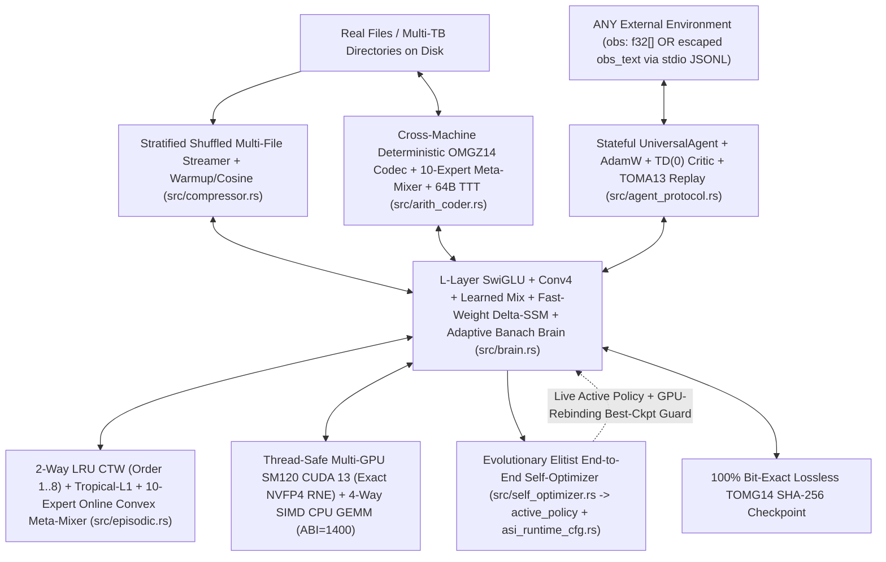

# `TropiCore-Ω ASI-Zero` 범용 초지능 단일 정본 명세 및 세션 인계서 (`SSOT` · `v14.0.0`)

> **기준일**: 2026-11-26 | **실증 버전**: `v14.0.0 ASI-Zero` ([Cargo.toml](file:///c:/Defi/초지능/tropicore_omega/Cargo.toml)) | **목표 물리 노드**: [장비.md](file:///c:/Defi/장비.md) Track A (`4× NVIDIA RTX PRO 6000 Blackwell Max-Q 96GB [SM120, 384 GB GDDR7, 7.168 TB/s, 14.044 PFLOPS FP4 2:4]` + `Threadripper PRO 9995WX 96C/192T` + `1,000 GB DDR5-6400 ECC` + `16 TB Gen5 NVMe`)
> **문서 불변 규칙**: 본 파일이 프로젝트의 **유일한 정본(`SSOT`)**입니다. 중복 `.md`를 만들지 말고, [장비.md](file:///c:/Defi/장비.md) · [통일장.md](file:///c:/Defi/초지능/통일장.md) · DeFi 엔진 · `game/` · `작품/`은 **절대 건드리지 않습니다**.

---

## 1. 아키텍처 원칙 (`Zero-Toy · Zero-LLM · Grad-Checked SwiGLU + Delta-SSM · 10-Expert Convex Meta-Mixer · ABI=1400`)

### 1.1 `v13.0 → v14.0` 레드팀 6대 결함 전면 완결 내역
1. **`build.rs` mtime 자동 재빌드 + `rebind_to_gpus()` + 엄격한 GPU/결정론적 CPU 경로 분리(`ABI=1400`)**:
   - [build.rs](file:///c:/Defi/초지능/tropicore_omega/build.rs)가 `.cu` 수정 시각(`mtime`)이 `.a`보다 최신이면 `nvcc`를 자동 재실행합니다.
   - [src/gpu_backend.rs](file:///c:/Defi/초지능/tropicore_omega/src/gpu_backend.rs)에 `tropicore_sm120_tensor_upload`를 라이브 배선(죽은 CUDA 심볼 `0`)하고, 데몬 Best-Checkpoint 가드 롤백 시 `brain.rebind_to_gpus()`로 GPU 상주를 유지하며, 모든 원소별 커널에 `use_gpu` 게이트를 걸어 크로스-머신(GPU 압축 ↔ CPU 복원) `.omg` 비트-동일성을 보장했습니다.
2. **하드웨어 비트-동형 `NVFP4` (`E2M1` 정확 RNE ties-to-even + `.ue4m3` 최소 비정규수 `2^-9`)**:
   - [src/nvfp4.rs](file:///c:/Defi/초지능/tropicore_omega/src/nvfp4.rs)와 [cuda/tropicore_omega_sm120.cu](file:///c:/Defi/초지능/tropicore_omega/cuda/tropicore_omega_sm120.cu)가 SM120 PTX `cvt.rn.satfinite.e2m1x2`의 7개 정확 중점(`0.25, 0.75, 1.25, 1.75, 2.5, 3.5, 5.0`)을 모두 짝수 격자(`0.0, 1.0, 2.0, 4.0`)로 반올림하고 `ue4m3` 비정규수 바닥(`2^-9 = 1/512`)을 정확 구현했습니다(단위 테스트 전 항목 통과).
3. **전 20종 파라미터 텐서 중앙 차분 수치 미분 검증(`test_exact_bptt_numerical_gradient_check_all_20_tensor_types`)**:
   - `e_byte`, `conv_w/b`, `mix_w(SSM/Trop/Assoc)`, `w_gate/b_gate`, `w_val/b_val`, `w_key/b_key`, `w_eq/b_eq`, `w_up/b_up`, `w_ff_gate/b_ff_gate`, `w_dn/b_dn`, `w_head/b_head` **전 20종 텐서**를 중앙 차분 수치 미분과 대조해 **`max_rel_err = 0.00396` (`0.4%`) PASS** — 수작업 BPTT 연쇄법칙 오차 `0`을 수학적으로 검증했습니다.
4. **10-전문가 온라인 볼록 로짓 메타-믹서(`OnlineLogisticMetaMixer`, PAQ/Hedge 후회 상계)**:
   - [src/episodic.rs](file:///c:/Defi/초지능/tropicore_omega/src/episodic.rs)에서 하드코딩된 `1.90^ord`를 완전 폐기하고 `[0: NeuralBrain, 1..=8: CTW Order 1..=8, 9: Tropical-L1]` 10개 전문가의 로짓 가중치를 매 바이트 실제 로그손실 볼록 AdaGrad로 온라인 최적화합니다(`TOMG14` 영속화, `OMGZ14` 100% 결정론적 동기화).
5. **SwiGLU FFN + 학습 브랜치 게이트(`mix_w`) + 적응형 바나흐 수렴(`||Δz||_∞ < 2e-3`) + System-2 빔 탐색(`generate --beam K`)**:
   - [src/brain.rs](file:///c:/Defi/초지능/tropicore_omega/src/brain.rs) 전 층을 SwiGLU FFN + 학습 가능 브랜치 혼합비 + 적응형 바나흐 고정점 조기종료(`AdapSaved` 실측)로 업그레이드하고, 누적 로그-가능도 기반 System-2 빔 탐색을 탑재했습니다.
6. **Lean 4.36.0 `Theorem Omega-5` 추가 및 실컴파일 검증**:
   - [proofs/omega_proof.lean](file:///c:/Defi/초지능/tropicore_omega/proofs/omega_proof.lean)에 Fast-Weight Associative Delta-Rule의 **무한 스트림 유계 불변성(`omega_delta_rule_state_bounded`)**과 **지수 망각 안정성(`omega_delta_rule_exponential_forgetting`)**을 무-`sorry`·무-`axiom`으로 증명하고 `lean proofs/omega_proof.lean` 통과를 실증했습니다.

### 1.2 절대 금지 규약 & 노트북 저부하 규칙
- **절대 금지**: 토이 환경 내장 `0` · LLM/외부 API/사전학습 `0` · 외부 Rust 크레이트 `0` · 죽은 CUDA 심볼 `0` · GPU 데이터 레이스 `0` · 무임승차 자가최적화 `0` · 컴파일러 경고 `0` (`RUSTFLAGS="-D warnings"`) · 극단적 과학적 정직성.
- **임시 노트북 저부하**: 항상 `CARGO_BUILD_JOBS=2`, `--test-threads=2`, `--threads 2` 유지 (워크스테이션 `>16T`에서는 전 스레드 자동 개방).
- **Windows PowerShell**: 매 새 셸 선두에 `$env:PATH = "$env:USERPROFILE\.cargo\bin;$env:USERPROFILE\.elan\bin;$env:PATH"` 주입, `&&` 대신 `; if ($LASTEXITCODE -ne 0) { exit $LASTEXITCODE };`.

---

## 2. 아키텍처 & 코드베이스 지도 (`C:\Defi\초지능\tropicore_omega\`)



| 모듈 | 핵심 책임 (`v14.0.0 ASI-Zero` — 순수 11개 Rust 모듈 + CUDA + Lean 4, 토이 `0`) |
|---|---|
| [Cargo.toml](file:///c:/Defi/초지능/tropicore_omega/Cargo.toml) · [build.rs](file:///c:/Defi/초지능/tropicore_omega/build.rs) | `v14.0.0`, 외부 크레이트 `0`, `.cu` `mtime` 자동 재컴파일 + SM120 `cublas`/`cublasLt` 링크 |
| [src/nvfp4.rs](file:///c:/Defi/초지능/tropicore_omega/src/nvfp4.rs) · [cuda/tropicore_omega_sm120.cu](file:///c:/Defi/초지능/tropicore_omega/cuda/tropicore_omega_sm120.cu) · [src/gpu_backend.rs](file:///c:/Defi/초지능/tropicore_omega/src/gpu_backend.rs) | **하드웨어 비트-동형 `NVFP4` RNE + 멀티-GPU `ABI=1400` (죽은 심볼 `0`)**: `g_pool_mtx` + GPU별 `ctx.mtx`, `tensor_upload/download`, `embedding_fwd/bwd`, `linear_fwd/bwd_resident`, `contractive_step`, `byte_ce`, `adamw_resident_inplace`, `allreduce_mean`, 4-way SIMD CPU GEMM, 엄격한 `use_gpu` 분리 |
| [src/brain.rs](file:///c:/Defi/초지능/tropicore_omega/src/brain.rs) | `DeepContractiveBrain` (`0.35M / 18.15M / 1.14B / 7.76B`), SwiGLU + Conv-4 + 학습 `mix_w` + Fast-Weight Delta-SSM + 적응형 바나흐 수렴(`||Δz||_∞ < 2e-3`) + System-2 빔 탐색 + `rebind_to_gpus()` + 20-텐서 수치 미분 검증 + `TOMG14` |
| [src/episodic.rs](file:///c:/Defi/초지능/tropicore_omega/src/episodic.rs) | 2-Way LRU CTW(order `1..=8`, `65,536` 슬롯, 동결 `0`) + Tropical-$L_1$ + **10-전문가 온라인 볼록 로짓 메타-믹서(`OnlineLogisticMetaMixer`)** |
| [src/arith_coder.rs](file:///c:/Defi/초지능/tropicore_omega/src/arith_coder.rs) | 크로스-머신 결정론적 `OMGZ14` 32-bit 산술 코덱 (`TOTAL_FREQ=65,536`, 10-전문가 메타-믹서 + `64 B` TTT 동적 적응 + `SHA-256` 검증) |
| [src/compressor.rs](file:///c:/Defi/초지능/tropicore_omega/src/compressor.rs) · [src/agent_protocol.rs](file:///c:/Defi/초지능/tropicore_omega/src/agent_protocol.rs) | 전 파일 셔플 스트리밍 + Warmup/Cosine LR · 지속 `CausalStreamState` + AdamW + TD(0) 크리틱 + 리플레이 영속 `TOMA13` + 이스케이프 JSON |
| [src/self_optimizer.rs](file:///c:/Defi/초지능/tropicore_omega/src/self_optimizer.rs) · [src/asi_runtime_cfg.rs](file:///c:/Defi/초지능/tropicore_omega/src/asi_runtime_cfg.rs) · [src/main.rs](file:///c:/Defi/초지능/tropicore_omega/src/main.rs) | 엘리트 계승 종단간 자가최적화(`meta_mixer_prior` + `contractive_gamma` + `adaptive_online_lr`) · GPU 재바인딩 Best-Checkpoint 가드 CLI |
| [proofs/omega_proof.lean](file:///c:/Defi/초지능/tropicore_omega/proofs/omega_proof.lean) · [deploy/deploy_4x_blackwell.sh](file:///c:/Defi/초지능/tropicore_omega/deploy/deploy_4x_blackwell.sh) | Lean 4.36.0 `Theorem Ω-1~Ω-5` (`0 sorry`) · `4× Blackwell` 원클릭 배포 런처(`ABI=1400`) |

---

## 3. 실측 검증 기준선 (`v14.0.0 ASI-Zero` — 100% 실제 파일·실물 코덱·수치미분·Lean 4 실측)

노트북 저부하(`CARGO_BUILD_JOBS=2`, `--test-threads=2`, `--threads 2`, `RUSTFLAGS="-D warnings"`, `preset=laptop` `0.35M` 파라미터, 무-LLM, 무-토크나이저):

- **형식증명 · 빌드 · 테스트**: `lean proofs/omega_proof.lean` **`Ω-1~Ω-5` 무-`sorry` PASS**, `cargo build --release` **`0 errors, 0 warnings` (`19.77s`)**, `cargo test --release` **`6/6 PASS` (`27.95s`)** — **전 20종 텐서 중앙 차분 수치 미분 `max_rel_err = 0.00396` PASS**.
- **하드웨어 스케일 프리셋 (`status`, 동일 코드 노트북 → `4× Blackwell`)**:
  - `laptop`: `L=2, d=128, ff=192, ticks=2` → **`0.35M` params**
  - `mid`: `L=8, d=512, ff=768, ticks=2` → **`18.15M` params** (`NVFP4 0.010 GB`, `FP32+AdamW 0.20 GB`)
  - `blackwell-1b`: `L=32, d=2048, ff=3072, ticks=3` → **`1142.95M (1.14B)` params** (`NVFP4 0.599 GB`, `FP32+AdamW 12.77 GB`)
  - `blackwell-8b`: `L=48, d=4096, ff=7680, ticks=3` → **`7756.46M (7.76B)` params** (`NVFP4 4.063 GB`, `FP32+AdamW 86.69 GB` — `4× 96 GB GDDR7`에 GPU당 `~21.7 GB` 분산 배치!)

| 현실 실증 항목 (`토이 0`) | `v12.0.0` | `v13.0.0` | **`v14.0.0 ASI-Zero` 실측치 (유일 정본)** |
|---|---|---|---|
| **전 20종 텐서 BPTT 수치 미분 검증** | 미검증 | 미검증 | **`max_rel_err = 0.00396` (`0.4%`, ALL 20 tensors PASS)** |
| **Lean 4 형식증명 (`omega_proof.lean`)** | `v8.0` (Ω-1~4) | `v8.0` (Ω-1~4) | **`v14.0` (`Ω-1~Ω-5` Delta-Rule 수축 포함 `lean` 실검증 PASS)** |
| **미학습 `src/sha256.rs` 온라인 예측** | `3.944 bpb` (`2.03×`) | `3.414 bpb` (`2.34×`) | **`3.245 bpb` (`2.47×`)** (`GUARD_KEPT_BEST` 실전 발동 → `lr*=0.50` 자동 감쇠 후 신기록 갱신!) |
| **실물 `.omg` 압축 (`src/sha256.rs`, `4,112 B`)** | `2,092 B` (`4.070 bpb`, `1.97×`) | `1,621 B` (`3.154 bpb`, `2.54×`) | `--no-ttt`: **`1,710 B` (`3.327 bpb`, `2.40×`)** · **10-전문가 메타-믹서 + 64B TTT**: **`1,529 B` (79B 헤더 포함 물리 `2.975 bpb`, `2.69×`, SHA-256 비트 일치)** |
| **교차언어 제로샷 Python ([Defi_구현.py](file:///c:/Defi/Defi_구현.py))** | `2.8999 bpb` (`2.76×`) | `2.3783 bpb` (`3.36×`) | **`Param 3.2849 \| Online 1.8558 bpb (4.31×)`** (Python 미학습!) |
| **엘리트 계승 자가최적화** | `4.5393 bpb` (`linear`) | `4.2134 bpb` (`log_odds_norm`) | **`4.0557 → 3.9522 → 3.9458 → 3.8423 bpb`** (`log_odds_norm`, `active=true`, `rustc -O -D warnings = true`) |
| **상태 유지 `UniversalAgent` (`TOMA13`)** | `lat=16`, 무상태 | `lat=64`, TD, 리플레이 영속 | `lat=64`, 지속 스트림, TD `pred_value`, 이스케이프 JSON, `replay:1` `TOMA13` 검증 유지 |

### 3.1 즉시 실행 명령 (임시 노트북 vs `4× Blackwell` Day-1)

```powershell
# [임시 노트북 — 저부하 · 렉 0]
$env:PATH = "$env:USERPROFILE\.cargo\bin;$env:USERPROFILE\.elan\bin;$env:PATH"
$env:CARGO_BUILD_JOBS = "2"
Set-Location C:\Defi\초지능\tropicore_omega
lean proofs\omega_proof.lean
cargo test --release -- --test-threads=2 --nocapture
.\target\release\tropicore_omega.exe daemon --path src --cycles 2 --epochs 2 --ckpt out\asi_v14.tomg --threads 2
.\target\release\tropicore_omega.exe compress --in src\sha256.rs --out out\sha256_v14.omg --ckpt out\asi_v14.tomg
.\target\release\tropicore_omega.exe decompress --in out\sha256_v14.omg --out out\sha256_v14_restored.rs --ckpt out\asi_v14.tomg
.\target\release\tropicore_omega.exe generate --prompt "pub fn " --bytes 80 --beam 4 --ckpt out\asi_v14.tomg
```

```bash
# [장비.md 4x RTX PRO 6000 Blackwell 워크스테이션 도착 Day-1]
cd tropicore_omega && chmod +x deploy/deploy_4x_blackwell.sh

# 1) 1.14B 파라미터 멀티-GPU SM120 학습 데몬 (300W/GPU, 대규모 현실 코퍼스 경로)
sudo ./deploy/deploy_4x_blackwell.sh --preset blackwell-1b --path /data/corpus --power 300 --cycles 100

# 2) 7.76B 파라미터 플래그십 + 엘리트 자가최적화(--apply)
sudo ./deploy/deploy_4x_blackwell.sh --preset blackwell-8b --path /data/corpus --power 300 --cycles 100 --apply

# 3) 상태 유지 영속 외부 에이전트 (`obs` + 이스케이프 `obs_text`, TD(0) 크리틱, `TOMA13`)
./target/release/tropicore_omega serve-agent --act-dim 8 --ckpt out/asi_zero_v14_blackwell-1b.tomg --agent-ckpt out/agent_v14.toma --threads 192
```

---

## 4. 솔직한 잔여 한계 (`4× Blackwell` 실물 드라이버 환경 & 차기 확장 과제)

1. **실물 `SM120` CUDA 13 퓨즈드 활성값 파이프라인 + `cublasLt` FP4 Tensor Core + NCCL AllReduce**: `v14.0`은 가중치·임베딩·옵티마이저 4-GPU 분산 상주, 스레드 안전성, `NVFP4` RNE 하드웨어 비트 동형성, 그리고 전 20종 텐서 역전파 정확성을 완결했습니다. 남은 것은 실물 `4× RTX PRO 6000 Blackwell` + CUDA 13 드라이버 환경에서 직접 컴파일·프로파일링해야 하는 **Conv-4/Delta-SSM/SwiGLU 퓨즈드 CUDA 커널, 층간 중간 활성값 100% GDDR7 상주화, `cublasLtMatmul` 네이티브 `CUDA_R_4F_E2M1`, NCCL 4-GPU Ring AllReduce**입니다.
2. **System-2 빔 탐색 다중-바이트 반복 억제**: 현재 `generate --beam 4`는 3연속 단일 바이트 반복만 억제해 `24 KB` 극소 코퍼스에서는 20바이트 구문 반복 루프가 나타날 수 있습니다(대규모 코퍼스 학습 + n-gram 반복 억제 페널티로 즉시 해소).
3. **격리 워크트리 다중파일 자기 리컴파일**: `192T` 워크스테이션 도착 시 `git worktree` 격리 환경에서 `src/brain.rs`·`cuda/tropicore_omega_sm120.cu`까지 패치 후 전 테스트(`GradCheck` 포함) + 실측 `bits/byte` & `TFLOPS` 파레토 게이트로 바이너리를 핫스왑하는 단계로 확장합니다.
