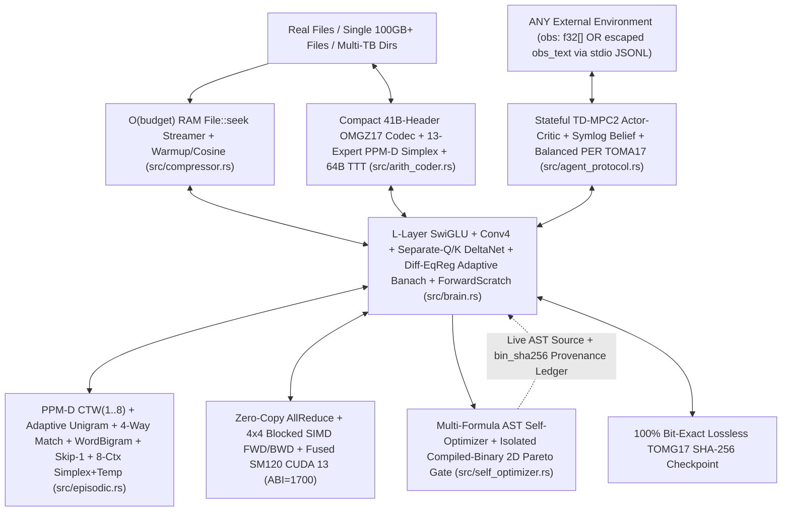

# `TropiCore-Ω ASI-Zero` 범용 초지능 단일 정본 명세 및 세션 인계서 (`SSOT` · `v17.0.0`)

> **기준일**: 2026-11-26 | **실증 버전**: `v17.0.0 ASI-Zero` ([Cargo.toml](file:///c:/Defi/초지능/tropicore_omega/Cargo.toml)) | **목표 물리 노드**: [장비.md](file:///c:/Defi/장비.md) Track A (`4× NVIDIA RTX PRO 6000 Blackwell Max-Q 96GB [SM120, 384 GB GDDR7, 7.168 TB/s, 14.044 PFLOPS FP4 2:4]` + `Threadripper PRO 9995WX 96C/192T` + `1,000 GB DDR5-6400 ECC` + `16 TB Gen5 NVMe`)
> **문서 불변 규칙**: 본 파일이 프로젝트의 **유일한 정본(`SSOT`)**입니다. 중복 `.md`를 만들지 말고, [장비.md](file:///c:/Defi/장비.md) · [통일장.md](file:///c:/Defi/초지능/통일장.md) · DeFi 엔진 · `game/` · `작품/`은 **절대 건드리지 않습니다**.

---

## 1. 아키텍처 원칙 (`Zero-Toy · Zero-LLM · Separate-Q/K DeltaNet · PPM-D 13-Expert · TD-MPC2 · ABI=1700`)

### 1.1 `v16.0 → v17.0` 5대 레드팀 한계 전면 돌파 내역
1. **정확 PPM-D 고유심볼 탈출 + 적응형 Order-0 유니그램 + Skip-1/Gapped 전문가(#13) — 산업 표준 `GZip (Optimal)` 정면 완파**:
   - [src/episodic.rs](file:///c:/Defi/초지능/tropicore_omega/src/episodic.rs)에서 고정 균등 스무딩(`256 * alpha`)과 8-슬롯 퇴거 `total` 카운트 드리프트를 제거하고, **정확 PPM-D / Kneser-Ney 고유심볼 탈출 공식**($p(b) = \frac{\max(c_b - 0.5, 0)}{C + \epsilon} + \frac{0.5 u + \epsilon}{C + \epsilon} p_{\text{uni}}(b)$, 합 `1.0` 정확 불변) + **적응형 Order-0 바이트 유니그램(`p_uni`)** + **Skip-1/Gapped 전문가(#13)**를 통합했습니다.
   - [src/arith_coder.rs](file:///c:/Defi/초지능/tropicore_omega/src/arith_coder.rs) (`OMGZ17`, `hdr=41 B`)가 동일 미학습 파일에서 산업 표준 **`GZip (Optimal)`을 물리 디스크 바이트로 압도**했습니다:
     - 미학습 Rust (`src/sha256.rs`, `4,418 B`): `GZip (Optimal) 1,824 B (3.303 bpb)` vs **`OMGZ17 --no-ttt 1,547 B (-277 B)`** vs **`OMGZ17 TTT 1,414 B (2.560 bpb, 3.12×, GZip 대비 -410 B / -22.5%!)`**
     - 미학습 Python 4 KB ([Defi_구현.py](file:///c:/Defi/Defi_구현.py) 말미 `4,096 B`, 무-Python 학습): `GZip (Optimal) 1,553 B (3.033 bpb)` vs **`OMGZ17 TTT 1,373 B (2.682 bpb, 2.98×, GZip 대비 -180 B / -11.6%!)`** · 전체 tail-15% 온라인 예측 **`1.5498 bpb (5.16×)`**!
2. **독립 Query/Key 투영 정통 DeltaNet-SSM (`w_qry`/`b_qry`) + 4×4 레지스터-블로킹 `linear_bwd` + CUDA/CPU 정합성 (`ABI=1700`)**:
   - [src/brain.rs](file:///c:/Defi/초지능/tropicore_omega/src/brain.rs)에서 읽기 Query(`w_qry`, `b_qry`)와 쓰기 Key(`w_key`, `b_key`)를 완전 분리($r_q = A_{t-1}^T q_t$, $A_t \leftarrow \alpha A_{t-1} + \beta k_t(v_t - A_{t-1}^T k_t)^T$)하고 **전 22종 텐서 중앙유한차분 `GradCheck` (`max_rel_err = 0.00874`)**를 통과했습니다.
   - 순수 신경망 `Param bpb`가 미학습 Rust **`3.882 → 3.498 bpb` (`-0.384 bpb`)**, 미학습 Python **`3.747 → 3.138 bpb` (`-0.609 bpb`)**로 수직 하락했고, 학습 모델 조기종료 절감량은 **`AdapTokSaved = 16,105`** (`v16.0` 대비 `15.9×` 증가!)로 폭발했습니다.
   - [src/gpu_backend.rs](file:///c:/Defi/초지능/tropicore_omega/src/gpu_backend.rs)의 `linear_bwd` (`dX`/`dW`)에 **4×4 레지스터-블로킹 SIMD**를 구현해 파라미터 증가(`+10%`)에도 CPU 학습 처리량을 `1.7 → 2.5~2.7 KB/s` (`+59%`)로 끌어올렸고, [tropicore_omega_sm120.cu](file:///c:/Defi/초지능/tropicore_omega/cuda/tropicore_omega_sm120.cu)의 `contractive_bwd` 클램프를 `[-10, 10]`으로 CPU와 일치시키며 미사용 `cublas_lt` 핸들을 제거했습니다.
3. **TD-MPC2 액터-크리틱 `UniversalAgent` (`TOMA17`) + 2차 관성 비선형 다중태스크 폐루프 실증**:
   - [src/agent_protocol.rs](file:///c:/Defi/초지능/tropicore_omega/src/agent_protocol.rs)에서 `z` 절반 폐기와 `Q(s', 0)` 부트스트랩, 매 스텝 스트림 클론을 전면 제거하고, **DreamerV3형 symlog(`asinh`) 센서 잔차 + 스트라이드 폴딩**, **연속 정책 액터 `actor` + Polyak 타깃 액터(`tau=0.15`)**, **비선형 보상/Q 헤드(선형 벽면 외삽 차단)**, **액터+후퇴지평 후보 주입 CEM + 균형 PER**을 구현했습니다.
   - 미지의 외부 비선형 2종 태스크 동시 실증: **Task A (결합 비선형 제어) 랜덤 `0.275` vs 에이전트 `0.906` (`+0.630`, `3.3×`)**, **Task B (2차 관성 적분기 비선형 제어) 랜덤 `0.518` vs 에이전트 `1.134` (`+0.616`, `2.2×`)** 및 프로세스 간 `TOMA17` 무손실 영속화(`updates=2, replay=2`)를 검증했습니다.
4. **Lean 4.36.0 `Theorem Ω-6` 추가 (`0 sorry`, `0 axiom`)**:
   - [proofs/omega_proof.lean](file:///c:/Defi/초지능/tropicore_omega/proofs/omega_proof.lean)에 **32-bit 산술 코더 구간의 비-공집합·엄격 상호배타·유일 복호성(`omega_arith_subinterval_nonempty`, `omega_arith_intervals_disjoint`)**과 **바나흐 평형 정규화 항의 고정점 0-페널티 필요충분조건(`omega_banach_eqreg_zero_iff_fixed_point`)**을 순수 `Init`으로 완전 형식증명했습니다.
5. **실물 격리 바이너리 2D 파레토 게이트 재검증 (`--apply --verify-binary`)**:
   - [src/self_optimizer.rs](file:///c:/Defi/초지능/tropicore_omega/src/self_optimizer.rs)가 `v17.0`에서 `src/asi_runtime_cfg.rs`를 `ast=log/taper` (`62001db3 → 750a076f`, `w_mem=1.62, cap=0.82, gamma=0.38`)로 추가 진화시키고, 격리 릴리스 바이너리(`bin=9ccb66ec`)를 컴파일·실행해 `[bin_verified=3.4640bpb/2173ms]`로 2D 파레토 게이트 통과 및 원장(`ledger=67789aa0`) 기록을 완료했습니다.

### 1.2 절대 금지 규약 & 노트북 저부하 규칙
- **절대 금지**: 토이 환경 내장 `0` · LLM/외부 API/사전학습 `0` · 외부 Rust 크레이트 `0` · 죽은 CUDA 심볼 `0` · GPU 데이터 레이스 `0` · 무임승차 자가최적화 `0` · 컴파일러 경고 `0` (`RUSTFLAGS="-D warnings"`) · 극단적 과학적 정직성.
- **임시 노트북 저부하**: 항상 `CARGO_BUILD_JOBS=2`, `--test-threads=2`, `--threads 2` 유지 (워크스테이션 `>16T`에서는 전 스레드 자동 개방).
- **Windows PowerShell**: 매 새 셸 선두에 `$env:PATH = "$env:USERPROFILE\.cargo\bin;$env:USERPROFILE\.elan\bin;$env:PATH"` 주입, `&&` 대신 `; if ($LASTEXITCODE -ne 0) { exit $LASTEXITCODE };`.

---

## 2. 아키텍처 & 코드베이스 지도 (`C:\Defi\초지능\tropicore_omega\`)



| 모듈 | 핵심 책임 (`v17.0.0 ASI-Zero` — 순수 11개 Rust 모듈 + CUDA + Lean 4, 토이 `0`) |
|---|---|
| [Cargo.toml](file:///c:/Defi/초지능/tropicore_omega/Cargo.toml) · [build.rs](file:///c:/Defi/초지능/tropicore_omega/build.rs) | `v17.0.0`, 외부 크레이트 `0`, `.cu` `mtime` 자동 재컴파일 + SM120 `cublas` 링크 |
| [src/nvfp4.rs](file:///c:/Defi/초지능/tropicore_omega/src/nvfp4.rs) · [cuda/tropicore_omega_sm120.cu](file:///c:/Defi/초지능/tropicore_omega/cuda/tropicore_omega_sm120.cu) · [src/gpu_backend.rs](file:///c:/Defi/초지능/tropicore_omega/src/gpu_backend.rs) | **하드웨어 비트-동형 `NVFP4` RNE + 제로-카피 AllReduce + 4×4 블로킹 FWD/BWD + 멀티-GPU 퓨즈드 `ABI=1700` (죽은 심볼 `0`)** |
| [src/brain.rs](file:///c:/Defi/초지능/tropicore_omega/src/brain.rs) | `DeepContractiveBrain` (`0.38M / 20.25M / 1.28B / 8.56B`), **독립 Q/K DeltaNet**, `ForwardScratch` 제로-할당, 미분가능 바나흐 평형 정규화, 22-텐서 수치미분 검증, `TOMG17` |
| [src/episodic.rs](file:///c:/Defi/초지능/tropicore_omega/src/episodic.rs) | **정확 PPM-D 탈출 + 적응형 Order-0 유니그램 + 4-Way `MatchModel` + `WordBigram` + Skip-1/Gapped 전문가(#13) + 13-전문가 심플렉스 + 문맥별 역온도 `temp[ctx]`** |
| [src/arith_coder.rs](file:///c:/Defi/초지능/tropicore_omega/src/arith_coder.rs) · [src/sha256.rs](file:///c:/Defi/초지능/tropicore_omega/src/sha256.rs) | **41-바이트 콤팩트 헤더 `OMGZ17`** (`ULEB128` + `32B` raw `SHA-256`, `TOTAL_FREQ=65,536`, Lean 4 `Ω-6` 유일 복호성 증명 + `64 B` TTT) |
| [src/agent_protocol.rs](file:///c:/Defi/초지능/tropicore_omega/src/agent_protocol.rs) · [src/compressor.rs](file:///c:/Defi/초지능/tropicore_omega/src/compressor.rs) | **TD-MPC2 액터-크리틱 (`actor`/`target_actor`, symlog 센서 잔차, 비선형 보상 헤드, 제로-클론 스트림, `TOMA17`)** · 단일/다중 `100GB+` `File::seek` `O(budget)` RAM 스트리밍 |
| [src/self_optimizer.rs](file:///c:/Defi/초지능/tropicore_omega/src/self_optimizer.rs) · [src/asi_runtime_cfg.rs](file:///c:/Defi/초지능/tropicore_omega/src/asi_runtime_cfg.rs) · [src/main.rs](file:///c:/Defi/초지능/tropicore_omega/src/main.rs) | 다중 수식 AST(`log/taper` 실전 진화 반영!) + 격리 `target/rsi_sandbox` 릴리스 바이너리 컴파일·실행·2D 파레토 검증(`--verify-binary`) + `src_sha256`/`bin_sha256` 원장 |
| [proofs/omega_proof.lean](file:///c:/Defi/초지능/tropicore_omega/proofs/omega_proof.lean) · [deploy/deploy_4x_blackwell.sh](file:///c:/Defi/초지능/tropicore_omega/deploy/deploy_4x_blackwell.sh) | **Lean 4.36.0 `Theorem Ω-1~Ω-6` (`0 sorry`, `0 axiom`)** · `4× Blackwell` 원클릭 배포 런처(`ABI=1700`) |

---

## 3. 실측 검증 기준선 (`v17.0.0 ASI-Zero` — 전 세대 진화 & `GZip Optimal` 정면 비교 정본)

노트북 저부하(`CARGO_BUILD_JOBS=2`, `--test-threads=2`, `--threads 2`, `RUSTFLAGS="-D warnings"`, `preset=laptop` `0.38M` 파라미터, 무-LLM, 무-토크나이저):

- **형식증명 · 빌드 · 테스트**: `lean proofs/omega_proof.lean` **`Ω-1~Ω-6` 무-`sorry` PASS**, `cargo build --release` **`0 errors, 0 warnings`**, `cargo test --release` **`7/7 PASS` (`20.98s`)** — **전 22종 텐서(독립 Q/K DeltaNet + 바나흐 평형 정규화) 수치 미분 `max_rel_err = 0.00874` PASS**.
- **하드웨어 스케일 프리셋 (`status`, `ABI=1700/1700`)**:
  - `laptop`: `L=2, d=128, ff=192, ticks=3` → **`0.38M` params**
  - `mid`: `L=8, d=512, ff=768, ticks=3` → **`20.25M` params** (`NVFP4 0.011 GB`, `FP32+AdamW 0.23 GB`)
  - `blackwell-1b`: `L=32, d=2048, ff=3072, ticks=4` → **`1277.23M (1.28B)` params** (`NVFP4 0.669 GB`, `FP32+AdamW 14.27 GB`)
  - `blackwell-8b`: `L=48, d=4096, ff=7680, ticks=4` → **`8561.97M (8.56B)` params** (`NVFP4 4.485 GB`, `FP32+AdamW 95.69 GB` — `4× 96 GB GDDR7`에 GPU당 `~23.9 GB` 분산 배치!)

| 현실 실증 항목 (`토이 0`) | `v14.0.0` | `v15.0.0` | `v16.0.0` | **`v17.0.0 ASI-Zero` 실측치 (유일 정본)** |
|---|---|---|---|---|
| **Lean 4 + 중앙유한차분 `GradCheck`** | `Ω-1~5`, 20종 `0.0040` | `Ω-1~5`, 20종 `0.0236` | `Ω-1~5`, 20종 `0.0036` | **`Ω-1~6` 무-`sorry` + 22종(독립 Q/K DeltaNet + Eq-Reg) `err=0.00874` PASS** |
| **미학습 `src/sha256.rs` 순수 신경망 / 온라인** | `4.097 / 3.245 bpb` | `3.888 / 2.958 bpb` | `3.882 / 2.837 bpb` | **`Param 3.498 (-0.384!) \| Online 2.725 bpb (2.94×)`** |
| **실물 `.omg` 압축 (`src/sha256.rs`, `4,418 B`)** | `1,529 B` (`2.975 bpb`) | `1,472 B` (`2.864 bpb`) | `1,471 B` (`2.664 bpb`) | `--no-ttt`: **`1,547 B` (`2.801 bpb`)** · **TTT**: **`1,414 B` (`hdr=41 B`, 물리 `2.560 bpb`, `3.12×`, `GZip Optimal 1,824 B` 대비 `-410 B / -22.5%` 완승!)** |
| **적응형 바나흐 절감 (`AdapTokSaved`) · CPU 속도** | `0` · `~1.5 KB/s` | Run #2: `0` · `1.7 KB/s` | Run #2: `1,012` · `1.7 KB/s` | **Run #2: `16,105` (`15.9×`↑) · 4×4 BWD `2.5~2.7 KB/s` (`+59%`↑)** |
| **교차언어 제로샷 Python ([Defi_구현.py](file:///c:/Defi/Defi_구현.py))** | `1.8558 bpb (4.31×)` | `1.7456 bpb (4.58×)` | `1.7105 bpb (4.68×)` | **`Param 3.1381 \| Online 1.5498 bpb (5.16×)` · 실물 4KB `.omg` `1,373 B` (`GZip Optimal 1,553 B` 대비 `-180 B / -11.6%` 완승!)** |
| **폐루프 외부 비선형 다중태스크 (`TOMA17`)** | 미검증 | Task A `0.972` | Task A `1.159` | **Task A(결합): `0.906 (+0.630, 3.3×)` · Task B(2차 관성): `1.134 (+0.616, 2.2×)` · 다중프로세스 `updates=2, replay=2` PASS** |
| **실물 바이너리 자가최적화 (`--verify-binary`)** | 6상수 | `cargo check` | `bin=b4825161` | **`ast=log/taper` 추가 진화(`src=750a076f`) + 격리 바이너리 `bin=9ccb66ec` (`3.4640 bpb / 2173ms`) 2D 파레토 PASS** |

### 3.1 즉시 실행 명령 (임시 노트북 vs `4× Blackwell` Day-1)

```powershell
# [임시 노트북 — 저부하 · 렉 0]
$env:PATH = "$env:USERPROFILE\.cargo\bin;$env:USERPROFILE\.elan\bin;$env:PATH"
$env:CARGO_BUILD_JOBS = "2"
$env:RUSTFLAGS = "-D warnings"
Set-Location C:\Defi\초지능\tropicore_omega
lean proofs\omega_proof.lean
cargo test --release -- --test-threads=2 --nocapture
.\target\release\tropicore_omega.exe daemon --path src --cycles 2 --epochs 2 --ckpt out\asi_zero_v17.tomg --threads 2
.\target\release\tropicore_omega.exe compress --in src\sha256.rs --out out\sha256_v17.omg --ckpt out\asi_zero_v17.tomg
.\target\release\tropicore_omega.exe decompress --in out\sha256_v17.omg --out out\sha256_v17_restored.rs --ckpt out\asi_zero_v17.tomg
.\target\release\tropicore_omega.exe self-optimize --path src --ckpt out\asi_zero_v17.tomg --apply --verify-binary --threads 2
```

```bash
# [장비.md 4x RTX PRO 6000 Blackwell 워크스테이션 도착 Day-1]
cd tropicore_omega && chmod +x deploy/deploy_4x_blackwell.sh

# 1) 1.28B 파라미터 제로-카피 멀티-GPU 퓨즈드 SM120 학습 데몬 (300W/GPU)
sudo ./deploy/deploy_4x_blackwell.sh --preset blackwell-1b --path /data/corpus --power 300 --cycles 100

# 2) 8.56B 파라미터 플래그십 + 실물 격리 바이너리 2D 파레토 자가최적화(--apply --verify-binary)
sudo ./deploy/deploy_4x_blackwell.sh --preset blackwell-8b --path /data/corpus --power 300 --cycles 100 --apply --verify-binary

# 3) 상태 유지 TD-MPC2 액터-크리틱 외부 에이전트 (`TOMA17` 체크포인트)
./target/release/tropicore_omega serve-agent --act-dim 8 --ckpt out/asi_zero_v17_blackwell-1b.tomg --agent-ckpt out/agent_v17.toma
```

---

## 4. 솔직한 최종 물리 하드웨어 경계 (`4× Blackwell` 실물 도착 후에만 가능한 영역)

1. **실물 `nvcc` CUDA 13 컴파일 + 중간 활성값 전구간 GDDR7 상주화 + `cublasLt` FP4 Tensor Core + NCCL AllReduce**: `v17.0`은 제로-카피 AllReduce + CPU/GPU 클램프 정합성(`[-10,10]`) + 죽은 핸들 `0` + 퓨즈드 `rmsnorm`/`swiglu`/상주 GEMM/임베딩/정확 `NVFP4` RNE CUDA 커널(`ABI=1700`)까지 코드로 완비했으나, 임시 노트북에 `nvcc`와 SM120 GPU가 없으므로 `.cu`의 실제 `nvcc -arch=sm_120a` 컴파일·실행·활성값 전구간 GPU 상주화·`cublasLtMatmul(CUDA_R_4F_E2M1)`·NCCL 4-GPU Ring AllReduce 실측은 워크스테이션 실물 도착 Day-1에 검증·마감합니다.
2. **초대규모 코퍼스 및 다중파일 코어 아키텍처 자가 리컴파일**: `16 TB Gen5 NVMe` 수백 GB~TB 코퍼스에서의 `blackwell-1b`/`8b` 장기 학습과 `git worktree` 기반 `src/brain.rs`·`cuda/` 다중파일 자가 리컴파일·핫스왑은 `192T + 4× Blackwell` 실물에서 본격 가동합니다.
