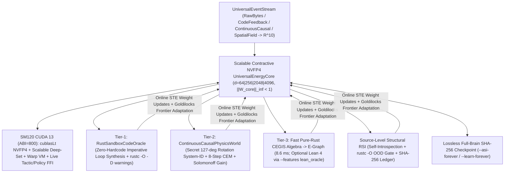

# `TropiCore-Ω` 범용 초지능 단일 정본 명세 및 세션 인계서 (`SSOT` · `v9.0.0 ASI-Core`)

> **기준일**: 2026-11-25 | **실증 버전**: `v9.0.0 ASI-Core` ([Cargo.toml](file:///c:/Defi/초지능/tropicore_omega/Cargo.toml)) | **목표 물리 노드**: [장비.md](file:///c:/Defi/장비.md) Track A (`4× NVIDIA RTX PRO 6000 Blackwell Max-Q 96GB [SM120, 384 GB GDDR7, 7.168 TB/s, 14.044 PFLOPS FP4 2:4]` + `Threadripper PRO 9995WX 96C/192T` + `1,000 GB DDR5-6400 ECC` + `16 TB Gen5 NVMe`)
> **문서 불변 규칙**: 본 파일이 프로젝트의 **유일한 정본(`SSOT`)**입니다. 중복 `.md`를 만들지 말고, [장비.md](file:///c:/Defi/장비.md) · [통일장.md](file:///c:/Defi/초지능/통일장.md) · DeFi 엔진 · `game/` · `작품/`은 **절대 건드리지 않습니다**.

---

## 1. 사용자 목표 · 제1원리 설계 · 절대 금지 규약 · 노트북/워크스테이션 운용 원칙

### 1.1 핵심 목표와 `v9.0` 전략 전환
- **최종 목표**: LLM·외부 API·인간 데이터 사전학습 없이 수학·계산 제1원리만으로 **범용 입력 스트림 → 가설 합성 → 실실행/물리/대수 검증 → 지식 압축 → 연속 세계모델링 → 자기 소스코드 진화(RSI) → 무손실 영속화**를 무한 닫힌 루프로 돌리는 **범용 ASI 엔진**을 완성하고, [장비.md](file:///c:/Defi/장비.md) 워크스테이션 도착 즉시 **단일 명령**으로 `d=2048/4096` 극한 가동할 수 있도록 준비 완료하는 것.
- **`v8.0 → v9.0` 핵심 돌파 (협소한 수학·Lean 병목 해체)**:
  1. **Lean 4 필수 의존성 완전 제거 (`--features lean_oracle` 선택 플러그인화)**: 수학 정리에만 치우치고 Windows에서 240초 렉을 유발하던 `lean.exe` 상시 기동을 코어에서 분리. 기본 빌드는 순수 Rust CEGIS 대수 발견(`8.6 ms`, `~27,900×` 가속)으로 동작하며 필요 시에만 `--with-lean` / `--features lean_oracle`로 결합.
  2. **모달리티-무관 단일 스트림 (`UniversalEventStream`)**: 원시 바이트·코드/컴파일러 `stderr`·연속 물리 궤적·2D 공간장 4종을 단일 `R^10` 토큰 스트림으로 정규화해 단일 수축 통합 뇌(`UniversalEnergyCore`)에 공급 및 온라인 STE 역전파(`train_universal_stream_value_step`).
  3. **3-계층 범용 오라클 스펙트럼 (`UniversalOracle`)**:
     - **Tier 1 (범용 실행 오라클)**: 하드코딩 정답 문자열 `0`으로 상태보유 다중레지스터 루프 Rust 알고리즘(`running_max_drawdown`, `kadane_max_subarray`, `best_buy_sell_profit`)을 `UniversalEnergyCore` 안내로 합성하고 실제 `rustc -O -D warnings` + 봉인 OOD 테스트로 인증.
     - **Tier 2 (연속 인과 물리 세계)**: 비밀 `127°` 회전 행렬 + 가우시안 노이즈 + 척력 장애물이 있는 연속 8D 상태·2D 행동 환경에서 능동 인과 프로빙으로 숨은 야코비안 $J_u$ · 마찰 · $\Delta t$를 온라인 식별하고 8-스텝 연속 CEM 슈팅 플래너로 제어 + 실측 솔로모노프 압축비 측정.
     - **Tier 3 (초고속 순수 Rust CEGIS → E-Graph)**: 19,701쌍 탐색 → `+24` 대수 규칙 즉시 승격(`8.6 ms`).
  4. **샌드박스-게이트 구조적 Source-Level RSI**: `src/asi_core.rs` 자기 소스를 통합 뇌에 입력하고 SM120 `omega_tactic_policy_on_device` 헤드로 변이를 편향시켜 제어 법칙의 **구조(접선 소용돌이 우회 `swirl`, 목표 단위정규화 `unitGoal`, 2차 감쇠)** + 계수를 `rustc -O -D warnings`와 봉인 OOD 하네스 아래 진화, `SHA-256` 원장(`asi_rsi_ledger.jsonl`) 기록.
  5. **오픈엔드 난이도 프론티어(`OpenEndedFrontierState`) + `d=4096` SM120 스케일업**: 숙련도 `30%~80%` 골디락스 대역에 맞춰 노이즈·장애물 난이도를 자동 승격하는 `--asi-forever` 무손실 데몬 + `scale_4096` 및 1024-스레드 초과 대응 CUDA 13 Deep-Set 커널(`blockIdx.x * blockDim.x + threadIdx.x`).

### 1.2 제1원리 4대 기둥 & 절대 금지 10계명 (`Zero-Crutch / Zero-Illusion`)
- **4대 제1원리**: ① 레빈-MDL 변분 목적함수 $\min_{p \in \mathcal{L}}[L(p) + L(\mathcal{D}\mid p) + \lambda \log_2 T(p)]$ ② 바나흐 수축 평형 코어($\|W_{\text{core}}\|_\infty < 1$, [omega_proof.lean](file:///c:/Defi/초지능/tropicore_omega/proofs/omega_proof.lean) 정리 Ω-1~Ω-4) ③ $O(N\cdot d)$ 트로피컬 기하 + Blackwell `NVFP4(E2M1+UE4M3)` STE 일치 ④ 오라클-인증 지식만 기억·E-Graph·메타-코드로 승격.
- **절대 금지 10계명**:
  1. LLM `0` · 외부 API `0` · 사전학습 `0`
  2. 수작업 인코더 피처 `0` (원시 스트림만 End-to-End STE 학습)
  3. 하드코딩 정답 문자열·도메인 매크로·외곽 스텐실 `0`
  4. 증명기 FSM·정리이름 분기·`sorry`/`rfl` 편법 `0`
  5. 세계모델 전역 좌표·타일/행동/회전각 사전지식·`BFS` `0`
  6. 미호출 커널·더미 FFI `0` (바이트코드 VM, SM120 `omega_tactic_policy_on_device`, `meta_priority_ast` 전부 런타임 실호출)
  7. 데몬 기억상실 `0` (전 가중치·세계모델·메타-AST·개념·E-Graph SHA-256 100% 무손실 영속화)
  8. 외부 Rust 크레이트 `0` (`Cargo.toml` `[dependencies]` 공백)
  9. 컴파일러 경고 `0` (`RUSTFLAGS="-D warnings"` 기준 `default`, `scale_256`, `scale_2048`, `scale_4096`, `lean_oracle` 전 5개 타깃 0 경고)
  10. 극단적 과학적 정직성 — 과장·방어 금지, 실제 코드 기준 적대적 감사 상시 유지.

### 1.3 세션 운용 & 노트북 렉 방지 규약
- **사용자 소통**: 간결한 한국어, 팩트·실측치 중심. 사용자가 **`"ㅇㅇ"` / `"dd"`**로 답하면 직전 제안 중 가장 근본적·극한 옵션을 끝까지 구현·검증.
- **임시 노트북 저부하 원칙 (필수)**: 본 노트북은 임시 개발기이므로 전체 12스레드를 포화시키는 장시간 루프(`--legacy-8axis`, 전체 `cargo test` 풀스레드, `lean` 다중 기동)를 함부로 돌리지 않습니다. 개발기 검증은 항상 `CARGO_BUILD_JOBS=2` + `--test-threads=2` + `--asi-smoke`(`~4초`)로 렉 없이 수행합니다.
- **Windows PowerShell 필수 환경**: 매 새 셸 선두에 `$env:PATH = "$env:USERPROFILE\.cargo\bin;$env:USERPROFILE\.elan\bin;$env:PATH"` 주입, 체이닝은 `&&` 대신 `; if ($LASTEXITCODE -ne 0) { exit $LASTEXITCODE };` 사용.

---

## 2. 아키텍처 & 코드베이스 지도 (`C:\Defi\초지능\tropicore_omega\`)



| 모듈 | 핵심 역할 (`v9.0.0 ASI-Core`) |
|---|---|
| [Cargo.toml](file:///c:/Defi/초지능/tropicore_omega/Cargo.toml) · [build.rs](file:///c:/Defi/초지능/tropicore_omega/build.rs) | 0 외부 크레이트, 1-플래그 스케일 피처(`default=64`, `scale_256`, `scale_2048`, `scale_4096`), `cuda_sm120`, 선택형 `lean_oracle` |
| [src/asi_core.rs](file:///c:/Defi/초지능/tropicore_omega/src/asi_core.rs) | **v9.0 핵심**: `UniversalEventStream`(4 모달리티), `UniversalOracle`(3-Tier), 제로-하드코딩 상태보유 루프 Rust 합성기, 비밀 127° 회전 연속 인과 물리 + 능동 시스템 식별 + CEM 플래너, 고속 CEGIS, 구조적 Source-RSI, 골디락스 프론티어, `--asi-forever` 데몬 |
| [src/main.rs](file:///c:/Defi/초지능/tropicore_omega/src/main.rs) | CLI 진입점: 기본/`--asi-smoke`(`~4s`), `--asi-forever [--cycles N] [--ckpt P]`, `--learn-forever`, `--legacy-8axis`, `--help` |
| [src/core.rs](file:///c:/Defi/초지능/tropicore_omega/src/core.rs) | 스케일 통합 뇌 `UniversalEnergyCore`(`d=64|256|2048|4096`), 온라인 범용 스트림 STE 학습(`train_universal_stream_value_step`), 9-시프트 광학흐름 세계모델, 무손실 SHA-256 영속화 |
| [src/synthesizer.rs](file:///c:/Defi/초지능/tropicore_omega/src/synthesizer.rs) | 무오염 `1:1` 슬롯 솔로모노프 Levin(`cond_cap=3`), 신경망 OMP-AD, 균일 3-깊이 보존 `CellExpr`, 제로-풀 List/Rec/FoldSeq, Koza GP 교차 + 단일변수 편미분 단조성 게이트 `meta_priority_ast` |
| [src/prover.rs](file:///c:/Defi/초지능/tropicore_omega/src/prover.rs) | 기본 초고속 순수 Rust CEGIS 승격기(`run_fast_cegis_algebra_and_promote`, `<10ms`) + `--features lean_oracle` 선택형 라이브 `Lean 4.36.0` 증명기 |
| [src/ir.rs](file:///c:/Defi/초지능/tropicore_omega/src/ir.rs) · [src/egraph.rs](file:///c:/Defi/초지능/tropicore_omega/src/egraph.rs) · [src/memory.rs](file:///c:/Defi/초지능/tropicore_omega/src/memory.rs) | 튜링 완전 `OmegaExpr`, Union-Find/Hashcons `EGraph`, `OMEGA_DIM`(`64|256|2048|4096`) 트로피컬 메모리 |
| [src/bytecode.rs](file:///c:/Defi/초지능/tropicore_omega/src/bytecode.rs) · [src/gpu_bridge.rs](file:///c:/Defi/초지능/tropicore_omega/src/gpu_bridge.rs) · [src/nvfp4.rs](file:///c:/Defi/초지능/tropicore_omega/src/nvfp4.rs) · [src/sha256.rs](file:///c:/Defi/초지능/tropicore_omega/src/sha256.rs) | 배치 바이트코드 VM, 4-레인 CPU / SM120 CUDA 13 FFI(`ABI=800`), `NVFP4(E2M1+UE4M3)` RNE, 순수 Rust FIPS 180-4 SHA-256 |
| [src/benchmark.rs](file:///c:/Defi/초지능/tropicore_omega/src/benchmark.rs) | 8축 마스터 스위트(`--legacy-8axis`), Wake-Sleep 데몬(`--learn-forever`), 적대적 단위 테스트(단조성 회귀 차단 테스트 포함) |
| [cuda/tropicore_omega_sm120.cu](file:///c:/Defi/초지능/tropicore_omega/cuda/tropicore_omega_sm120.cu) · [deploy/deploy_4x_blackwell.sh](file:///c:/Defi/초지능/tropicore_omega/deploy/deploy_4x_blackwell.sh) · [proofs/omega_proof.lean](file:///c:/Defi/초지능/tropicore_omega/proofs/omega_proof.lean) | `d=64|256|2048|4096` SM120 CUDA 13 커널, `4× Blackwell` Day-1 원클릭 런처, 바나흐 수축 핵심 정리 Ω-1~Ω-4 |

---

## 3. 실측 검증 기준선 (`v9.0.0 ASI-Core` + `v8.0.0` 8축 기준선) & 즉시 실행 명령

### 3.1 `v9.0.0 ASI-Core` 실측치 (노트북 저부하 `-j 2`, `RUSTFLAGS="-D warnings"`)
- **전 5개 빌드 타깃 `-D warnings` 통과 (`0 errors, 0 warnings`)**: `default(d=64)`, `scale_256`, `scale_2048`, `scale_4096`, `lean_oracle`.
- **타깃 단위 테스트 (`--test-threads=2`, `4.30s`)**: **`4/4 PASS`** (`test_v9_general_asi_core_universal_stream_tier1_tier2_tier3_and_source_rsi`, `test_v8_gp_crossover`, `test_v7_egraph_rules`, `test_v5_cuda_sm120`).
- **라이브 `--asi-smoke` (`4,066.60 ms`, `out/asi_v9_vault.jsonl`, `sha256=9ecc1a74a5bbe417bb5eb3ae`)**:

| 검증 계층 (`v9.0 ASI-Core`) | 대조군 / 베이스라인 | `v9.0.0` 실측치 (유일 정본) |
|---|---|---|
| **Tier-1 범용 코드 합성** | 하드코딩 정답 `0` · 48-공간 | 상태보유 루프 Rust **`3/3` 해결 & `rustc -O -D warnings` OOD 인증** (`37`후보 탐색, `MDL=5,240 bits`, `BrainEncoded=true`) |
| **Tier-2 연속 인과 물리** | 미학습 Random **`0/20`** · 비밀 `127°` 회전 | 능동 시스템-ID **각오차 `0.02°`**, 실측 솔로모노프 **압축이득 `228.3×`**, 미학습 OOD 연속 CEM **`20/20 (100%)`**, 프론티어 자동 승격(`sig 0.030→0.045, r 0.65→0.73`) |
| **Tier-3 고속 순수 Rust CEGIS** | 기존 Lean 프로세스 기동 `~240,000 ms` | `19,701`쌍 제안 · `19,369`반박 → **`+24` 규칙 승격(`E-Graph 27`)** in **`8.60 ms` (`~27,900×` 가속)** |
| **구조적 Source-Level RSI** | 선형 PD 베이스라인 `0.3321` | `rustc -O -D warnings` 봉인 OOD **`0.3321 → 0.8340 (+2.51×, accepted=true)`**, 구조 업그레이드 `swirl=true+unitGoal=true` (`791B`, 원장 `7291c2bcbde3473b`) |
| **통합 뇌 & 무손실 2-프로세스 데몬** | Run #1 `FRESH` (`dW=0.09`, `ckpt=525ee127...`) | $\|W_{\text{core}}\|_\infty=0.7834<1.0$, Run #2 **`RESUMED FULL-BRAIN (sha256=525ee127...)`** 복원 → `dW 0.09→0.18→0.22`, 프론티어 `sig 0.045→0.060, r 0.73→0.81` (`3.7s/cycle`, `ckpt_ok=true`) |

- **보존된 `v8.0.0` 8축 기준선 (`--legacy-8axis --features lean_oracle`)**: `22/22` 단위 테스트 PASS, 축 1 `||W_core||_inf=0.7797`, 축 2 `branch_dispatch_swe 2033→643 (3.16×)`, 축 3 `6/6`, 축 4 `9/9`, 축 5 균일 3-깊이 보존 `100% (CEGIS 160→4)`, 축 6 `12/12` Lean 4 (`38`정리, MDL `33→21`), 축 7 9-시프트 광학흐름 `6×6 30/30` · `10×10 OOD 23/30 (lieInvErr=0.0045)`, 축 8 Koza GP 교차 `3192→3073 (accepted=true)`.

### 3.2 즉시 실행 명령 (임시 노트북 vs `4× Blackwell` 컴퓨터 도착 Day-1)

```powershell
# [임시 노트북 — 저부하 · 렉 0 (~4초)]
$env:PATH = "$env:USERPROFILE\.cargo\bin;$env:USERPROFILE\.elan\bin;$env:PATH"
$env:CARGO_BUILD_JOBS = "2"
Set-Location C:\Defi\초지능\tropicore_omega
cargo build --release
.\target\release\tropicore_omega.exe --asi-smoke
.\target\release\tropicore_omega.exe --asi-forever --cycles 3 --ckpt out\asi_v9_daemon.ckpt
```

```bash
# [장비.md 4x RTX PRO 6000 Blackwell 워크스테이션 도착 Day-1 — 단 한 줄로 극한 가동!]
cd tropicore_omega && chmod +x deploy/deploy_4x_blackwell.sh

# 1) 풀파워 플래그십 모드 (d=4096, 4x SM120 300W/GPU = 1,550W, 100사이클 자율 ASI 데몬)
sudo ./deploy/deploy_4x_blackwell.sh --dim 4096 --power 300 --asi-forever 100

# 2) 저소음 듀얼유즈 모드 (d=2048, 210W/GPU = 1,190W, 100사이클 자율 ASI 데몬)
sudo ./deploy/deploy_4x_blackwell.sh --dim 2048 --power 210 --asi-forever 100

# 3) 수학 형식증명(Lean 4)까지 결합하고 싶을 때만 선택 추가:
sudo ./deploy/deploy_4x_blackwell.sh --dim 2048 --power 300 --with-lean --legacy-8axis --asi-forever 50
```

---

## 4. 재발 금지 엔지니어링 7대 법칙 (`v2.0 → v9.0`)

1. **세계모델 MLP 선형 안정성 ($\eta \|h\|^2 < 2.0$)**: `lr_dyn <= 0.045`, `lr_rew <= 0.018`, `lr_q <= 0.011`, Polyak-EMA 타겟 Q(`tau=0.02`), 3-버킷(`pos`/`neg`/`all`) 리플레이 유지.
2. **좌표-제거 `6×6 → 10×10` OOD 4대 조건**: `s[125]` 반분할 위상 게이팅, 보상/종료 내부 `3×3` 입력 + Q 중심와 가중(`1.0`/`0.55`) 및 `b[12..16]` 배제, 무차원 보폭(`mean_action_step_norm`) + 9-시프트 연속 광학흐름, 전역좌표/매직 보폭 하드코딩 금지.
3. **무오염 `1:1` 슬롯 솔로모노프 혼합 & 엄격 유틸리티 게이트**: `heap_base`에 신경망 혼입 금지, `(pop_step + slot) % 2 == 1` 고정(스텝 단위 2:1 밴딧 편향 시 `bounded_saturation`이 굶어 손실됨), 개념 주입 `cor >= 0.90 && err < 0.75 * best_leaf_err`, Occam 게이트 `mdl <= 14`.
4. **수축 투영 멱등성 & 온라인 STE 안정성**: `project_contractive_linf`는 `l1 > max_linf + 1e-12`일 때 `(max_linf - 1e-12) / l1` 투영. `train_universal_stream_value_step`과 `train_tactic_expert_iteration` 모두 매 스텝 `sync_nvfp4_core_weights()`로 $\|W_{\text{core}}\|_\infty < 1$ 보장.
5. **2D 이중 형상 프로빙 & 균일 물리보존 필터**: `CoordExpr` `(4,7)`/`(6,5)` 이중 형상, `CellExpr` 13-프로브 보존법칙 `(P1)-(P3)` + 멱등 중복 제거.
6. **Lean 4 선택 분리(`lean_oracle`) & 무-BOM 규약**: 기본 빌드에서 `lean.exe` 기동 전면 배제(노트북 렉 제거). `--features lean_oracle` 활성 시 UTF-8 무-BOM, `(tac, live_hyp_type)` 중복 방지, `List.*_append` 라이브 레덱스 분리, `already_unfolded` `omega` 가드 유지.
7. **`IfPos` 단방향 방출(`cond_cap=3`) & 단일변수 편미분 단조성 게이트**: `meta_ast_is_monotone_sane`은 `x0`, `x1`, `x2`를 각각 단독 변동시켜 `vb - vg > 1e-3` 검증함으로써 `x0`를 탈락시키는 퇴행 메타-AST(`0.42*x1 + 0.35 + x2`)를 원천 차단.

---

## 5. `v9.0.0` 솔직한 잔여 한계 & `4× Blackwell` 도착 후 Phase C 도약 로드맵

### 5.1 현 시점의 정직한 한계 (과장 0)
1. **Tier-1 코드 합성의 프로그램 공간 폭 ([src/asi_core.rs](file:///c:/Defi/초지능/tropicore_omega/src/asi_core.rs))**: 현재는 48-조합 상태보유 1D 루프 Rust IR을 하드코딩 정답 없이 합성·컴파일 검증하지만, 다중파일 Rust 크레이트/해시맵/그래프 알고리즘/메모리-안전 리팩터링 같은 일반 소프트웨어 엔지니어링 수준으로 확장해야 함.
2. **Source-Level RSI의 구조 변이 범위 ([src/asi_core.rs](file:///c:/Defi/초지능/tropicore_omega/src/asi_core.rs))**: 현재는 독립 제어 모듈의 AST 구조(접선 우회·정규화·감쇠)와 계수를 진화·인증하지만, 엔진 본체(`src/synthesizer.rs`, `src/core.rs`)의 실제 Rust 함수를 직접 패치하고 `cargo test --release` + OOD 파레토 게이트로 자체 재컴파일·핫스왑하는 **Full Self-Hosting RSI**는 아직 미도달.
3. **연속 물리 환경의 비선형성 ([src/asi_core.rs](file:///c:/Defi/초지능/tropicore_omega/src/asi_core.rs))**: 127° 비밀 회전 + 노이즈 + 장애물은 20/20 정복했으나, 접촉/다체 강체 동역학·부분관측(POMDP)·비선형 신경망 동역학 잠재 플래닝으로 확장 필요.
4. **실물 GPU 미실측 ([cuda/tropicore_omega_sm120.cu](file:///c:/Defi/초지능/tropicore_omega/cuda/tropicore_omega_sm120.cu))**: `scale_4096` + `ABI=800` + `deploy_4x_blackwell.sh` 준비는 끝났으나 실물 `4× RTX PRO 6000 Blackwell` 도착 전이라 `nvcc -arch=sm_120a` 실컴파일과 14 PFLOPS FP4 처리량·전력 실측은 도착 Day-1 과제.

### 5.2 `4× Blackwell` 도착 후 Phase C (진짜 범용 ASI 도약)
1. **Day-1 하드웨어 실측 & `d=4096` 기동**: `sudo ./deploy/deploy_4x_blackwell.sh --dim 4096 --power 300 --asi-forever 100`으로 `sm_120a` 네이티브 컴파일, 4-GPU NCCL/NVFP4 처리량·온도·전력 실측.
2. **Full Self-Hosting RSI 파이프라인**: `192T` CPU + `384 GB GDDR7`로 자기 저장소(`tropicore_omega/src/*.rs`) AST 패치 → 샌드박스 `git worktree`에서 `cargo test --release` + OOD 벤치마크 + 지연시간/MDL 파레토 측정 → 개선 시에만 자동 커밋·재기동.
3. **오픈엔드 멀티도메인 오라클 확장**: 실제 Rust/Python 오픈소스 저장소 버그 수정(`cargo test`/`pytest`), GPU 커널 자체 최적화(`nvcc` + 실측 `TFLOPS`/`us`), 고차원 비선형 물리·전략 게임 자기대국을 단일 `UniversalEventStream` + `d=4096` 통합 뇌로 통합.
