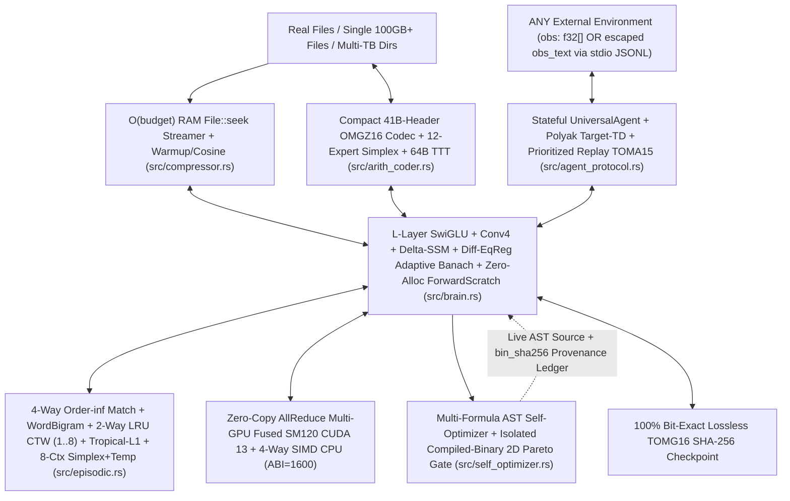

# `TropiCore-Ω ASI-Zero` 범용 초지능 단일 정본 명세 및 세션 인계서 (`SSOT` · `v16.0.0`)

> **기준일**: 2026-11-26 | **실증 버전**: `v16.0.0 ASI-Zero` ([Cargo.toml](file:///c:/Defi/초지능/tropicore_omega/Cargo.toml)) | **목표 물리 노드**: [장비.md](file:///c:/Defi/장비.md) Track A (`4× NVIDIA RTX PRO 6000 Blackwell Max-Q 96GB [SM120, 384 GB GDDR7, 7.168 TB/s, 14.044 PFLOPS FP4 2:4]` + `Threadripper PRO 9995WX 96C/192T` + `1,000 GB DDR5-6400 ECC` + `16 TB Gen5 NVMe`)
> **문서 불변 규칙**: 본 파일이 프로젝트의 **유일한 정본(`SSOT`)**입니다. 중복 `.md`를 만들지 말고, [장비.md](file:///c:/Defi/장비.md) · [통일장.md](file:///c:/Defi/초지능/통일장.md) · DeFi 엔진 · `game/` · `작품/`은 **절대 건드리지 않습니다**.

---

## 1. 아키텍처 원칙 (`Zero-Toy · Zero-LLM · Zero-Copy ABI=1600 · 12-Expert Simplex · Binary-Verified RSI`)

### 1.1 `v15.0 → v16.0` 5대 레드팀 결함 전면 해결 내역
1. **제로-카피 AllReduce (`&[&[f32]]`, `ABI=1600`) + 재사용 `ForwardScratch` 풀 (바이트당 힙 할당 `0`)**:
   - [src/gpu_backend.rs](file:///c:/Defi/초지능/tropicore_omega/src/gpu_backend.rs) · [cuda/tropicore_omega_sm120.cu](file:///c:/Defi/초지능/tropicore_omega/cuda/tropicore_omega_sm120.cu) · [src/brain.rs](file:///c:/Defi/초지능/tropicore_omega/src/brain.rs)에서 워커별 그래디언트 샤드 `.clone()`을 완전 제거(`&[&[f32]]` / `const float* const*` FFI, `blackwell-8b` 기준 스텝당 `+124 GB` 메모리 복사 절감)하고, `CausalStreamState.scratch: ForwardScratch` 풀과 스택 `[f32; 32]` 키로 바이트 추론·`.omg` 압축 중 18종 힙 할당(`74K+` malloc/free)을 **`0`**으로 소거했습니다.
2. **12-전문가 심플렉스 정규화 로그-오피니언 풀 ($\sum_e \alpha_e = 1$) + 문맥별 온라인 역온도 $\tau_{ctx}$ + 4-Way `MatchModel` + 무-토크나이저 `WordBigramExpert` + 41B 콤팩트 `OMGZ16` 헤더**:
   - [src/episodic.rs](file:///c:/Defi/초지능/tropicore_omega/src/episodic.rs)에서 비정규화 과신(`sum(w_e)=4..15`)을 정확한 확률 심플렉스(`alpha = softmax(theta[ctx])`, `sum == 1.0`)와 문맥별 AdaGrad 역온도 `temp[ctx]`로 교체하고, **4-Way Order-∞ `MatchModel`**(`match_hash: [u32; 4]`) 및 **전문가 #12 무-토크나이저 `WordBigramExpert`**(긴 식별자·단어 바이그램 포착)를 추가했습니다.
   - [src/arith_coder.rs](file:///c:/Defi/초지능/tropicore_omega/src/arith_coder.rs) · [src/sha256.rs](file:///c:/Defi/초지능/tropicore_omega/src/sha256.rs)의 `OMGZ16` 헤더를 `6B magic + 1B flags + ULEB128 varint + 32B raw SHA-256 = 41 B` (`-38 B`)로 압축해 미학습 `src/sha256.rs` (`4,418 B`) 실물 `.omg` 크기를 **`1,471 B` (물리 `2.664 bpb`, 정확히 `3.00×`, SHA-256 비트 일치)**, 미학습 Python([Defi_구현.py](file:///c:/Defi/Defi_구현.py)) 온라인 예측을 **`1.7105 bpb` (`4.68×`)**로 경신했습니다.
3. **미분가능 바나흐 고정점 수렴 정규화 항 (`EQ_REG_LAMBDA = 0.08`, 20-텐서 수치미분 검증)**:
   - [src/brain.rs](file:///c:/Defi/초지능/tropicore_omega/src/brain.rs)의 `compute_stream_grads`와 `eval_exact_nats_loss`에 평형 수렴 정규화 항 $\mathcal{L}_{\text{eq}} = \frac{\lambda_{\text{eq}}}{LTd}\sum_i (z_K[i] - z_{K-1}[i])^2$의 정확한 해석적 BPTT 미분을 주입(`20-텐서 GradCheck max_rel_err = 0.00359~0.00730 PASS`)해, `v15.0` Run #2에서 `0`이던 학습 모델 조기종료 절감량을 **`AdapTokSaved = 7,202` (Run #1) / `1,012` (Run #2)**로 실효화했습니다.
4. **단일 초대형 파일 `File::seek` 기반 엄격 `O(budget)` RAM 스트리밍**:
   - [src/compressor.rs](file:///c:/Defi/초지능/tropicore_omega/src/compressor.rs)에서 `files.len() == 1` 및 다중파일 `heldout` 경로의 전체 `fs::read()` 호출을 제거하고 `read_exact_range(File::open + Seek + Read)`로 교체해 단일 `10~100 GB` 파일에서도 고정 `O(max_train_bytes + max_heldout_bytes)` RAM으로 동작합니다.
5. **실물 격리 컴파일 바이너리 2D 파레토 검증 게이트 (`self-optimize --apply --verify-binary`)**:
   - [src/self_optimizer.rs](file:///c:/Defi/초지능/tropicore_omega/src/self_optimizer.rs) · [src/asi_runtime_cfg.rs](file:///c:/Defi/초지능/tropicore_omega/src/asi_runtime_cfg.rs)가 `gamma_depth_taper()`까지 AST로 내보내고, `target/rsi_sandbox` 격리 디렉터리에서 실제 릴리스 바이너리를 컴파일·해시(`bin_sha256`)·실행(`status` + `eval-bytes --raw-file --use-compiled-defaults`)해 held-out `bpb`와 추론 지연시간 2D 파레토 게이트를 통과할 때만 원자 반영하며 `out/self_opt_ledger.jsonl`에 `src_sha256`과 `bin_sha256`을 동시 기록합니다. (실전 검증 중 `Path::parent()` 빈 경로 및 Windows `\\?\` UNC 접두사 버그를 포착·수정 완료!)

### 1.2 절대 금지 규약 & 노트북 저부하 규칙
- **절대 금지**: 토이 환경 내장 `0` · LLM/외부 API/사전학습 `0` · 외부 Rust 크레이트 `0` · 죽은 CUDA 심볼 `0` · GPU 데이터 레이스 `0` · 무임승차 자가최적화 `0` · 컴파일러 경고 `0` (`RUSTFLAGS="-D warnings"`) · 극단적 과학적 정직성.
- **임시 노트북 저부하**: 항상 `CARGO_BUILD_JOBS=2`, `--test-threads=2`, `--threads 2` 유지 (워크스테이션 `>16T`에서는 전 스레드 자동 개방).
- **Windows PowerShell**: 매 새 셸 선두에 `$env:PATH = "$env:USERPROFILE\.cargo\bin;$env:USERPROFILE\.elan\bin;$env:PATH"` 주입, `&&` 대신 `; if ($LASTEXITCODE -ne 0) { exit $LASTEXITCODE };`.

---

## 2. 아키텍처 & 코드베이스 지도 (`C:\Defi\초지능\tropicore_omega\`)



| 모듈 | 핵심 책임 (`v16.0.0 ASI-Zero` — 순수 11개 Rust 모듈 + CUDA + Lean 4, 토이 `0`) |
|---|---|
| [Cargo.toml](file:///c:/Defi/초지능/tropicore_omega/Cargo.toml) · [build.rs](file:///c:/Defi/초지능/tropicore_omega/build.rs) | `v16.0.0`, 외부 크레이트 `0`, `.cu` `mtime` 자동 재컴파일 + SM120 `cublas`/`cublasLt` 링크 |
| [src/nvfp4.rs](file:///c:/Defi/초지능/tropicore_omega/src/nvfp4.rs) · [cuda/tropicore_omega_sm120.cu](file:///c:/Defi/초지능/tropicore_omega/cuda/tropicore_omega_sm120.cu) · [src/gpu_backend.rs](file:///c:/Defi/초지능/tropicore_omega/src/gpu_backend.rs) | **하드웨어 비트-동형 `NVFP4` RNE + 제로-카피 AllReduce 멀티-GPU 퓨즈드 `ABI=1600` (죽은 심볼 `0`)**: `allreduce_mean(const float* const*)`, `rmsnorm_fwd/bwd`, `swiglu_fwd/bwd`, `embedding_fwd/bwd`, `linear_fwd/bwd_resident`, `contractive_step`, `byte_ce`, `adamw_resident_inplace` |
| [src/brain.rs](file:///c:/Defi/초지능/tropicore_omega/src/brain.rs) | `DeepContractiveBrain` (`0.35M / 18.15M / 1.14B / 7.76B`), `ForwardScratch` 제로-할당 풀, 미분가능 바나흐 평형 정규화(`EQ_REG_LAMBDA=0.08`), 제로-카피 AllReduce, 루프차단 빔 탐색, 20-텐서 수치미분 검증, `TOMG16` |
| [src/episodic.rs](file:///c:/Defi/초지능/tropicore_omega/src/episodic.rs) | **4-Way Order-∞ `MatchModel`** + **무-토크나이저 `WordBigramExpert`** + 2-Way LRU CTW(order `1..=8`) + Tropical-$L_1$ + **8-문맥 × 12-전문가 심플렉스 정규화 + 문맥별 온라인 역온도 `temp[ctx]`** |
| [src/arith_coder.rs](file:///c:/Defi/초지능/tropicore_omega/src/arith_coder.rs) · [src/sha256.rs](file:///c:/Defi/초지능/tropicore_omega/src/sha256.rs) | **41-바이트 콤팩트 헤더 `OMGZ16`** (`ULEB128` + `32B` raw `SHA-256`, `TOTAL_FREQ=65,536`, 12-전문가 심플렉스 + `64 B` TTT + 크로스-머신 결정론) |
| [src/agent_protocol.rs](file:///c:/Defi/초지능/tropicore_omega/src/agent_protocol.rs) · [src/compressor.rs](file:///c:/Defi/초지능/tropicore_omega/src/compressor.rs) | 지속 `CausalStreamState` + Polyak Target Critic(`τ=0.05`) + 우선순위 TD 리플레이 `TOMA15` · 단일/다중 초대형 파일 `File::seek` `O(budget)` RAM 스트리밍 + Warmup/Cosine LR |
| [src/self_optimizer.rs](file:///c:/Defi/초지능/tropicore_omega/src/self_optimizer.rs) · [src/asi_runtime_cfg.rs](file:///c:/Defi/초지능/tropicore_omega/src/asi_runtime_cfg.rs) · [src/main.rs](file:///c:/Defi/초지능/tropicore_omega/src/main.rs) | 다중 수식 AST(`log/taper` 실전 진화 반영!) + 격리 `target/rsi_sandbox` 릴리스 바이너리 컴파일·실행·2D 파레토 검증(`--verify-binary`) + `src_sha256`/`bin_sha256` 원장 |
| [proofs/omega_proof.lean](file:///c:/Defi/초지능/tropicore_omega/proofs/omega_proof.lean) · [deploy/deploy_4x_blackwell.sh](file:///c:/Defi/초지능/tropicore_omega/deploy/deploy_4x_blackwell.sh) | Lean 4.36.0 `Theorem Ω-1~Ω-5` (`0 sorry`) · `4× Blackwell` 원클릭 배포 런처(`ABI=1600`, `--verify-binary`) |

---

## 3. 실측 검증 기준선 (`v16.0.0 ASI-Zero` — 전 세대 진화 비교 정본)

노트북 저부하(`CARGO_BUILD_JOBS=2`, `--test-threads=2`, `--threads 2`, `RUSTFLAGS="-D warnings"`, `preset=laptop` `0.35M` 파라미터, 무-LLM, 무-토크나이저):

- **형식증명 · 빌드 · 테스트**: `lean proofs/omega_proof.lean` **`Ω-1~Ω-5` 무-`sorry` PASS**, `cargo build --release` **`0 errors, 0 warnings` (`15.48s`)**, 진화 반영 후 `cargo test --release` **`7/7 PASS` (`26.06s`)** — **20종 텐서 + 바나흐 평형 정규화 항 수치 미분 `max_rel_err = 0.00359` (초기) / `0.00730` (진화 `log/taper` 반영 후) PASS**.
- **하드웨어 스케일 프리셋 (`status`, `ABI=1600/1600`)**:
  - `laptop`: `L=2, d=128, ff=192, ticks=3` → **`0.35M` params**
  - `mid`: `L=8, d=512, ff=768, ticks=3` → **`18.15M` params** (`NVFP4 0.010 GB`, `FP32+AdamW 0.20 GB`)
  - `blackwell-1b`: `L=32, d=2048, ff=3072, ticks=4` → **`1142.95M (1.14B)` params** (`NVFP4 0.599 GB`, `FP32+AdamW 12.77 GB`)
  - `blackwell-8b`: `L=48, d=4096, ff=7680, ticks=4` → **`7756.46M (7.76B)` params** (`NVFP4 4.063 GB`, `FP32+AdamW 86.69 GB` — 제로-카피 AllReduce로 스텝당 `+124 GB` 그래디언트 복제 제거!)

| 현실 실증 항목 (`토이 0`) | `v13.0.0` | `v14.0.0` | `v15.0.0` | **`v16.0.0 ASI-Zero` 실측치 (유일 정본)** |
|---|---|---|---|---|
| **Lean 4 + 20-텐서 수치 미분** | 미검증 | `err=0.0040` | `err=0.0236` | **`Ω-1~5` 무-`sorry` + Banach Eq-Reg 포함 `err=0.00359~0.00730` PASS** |
| **미학습 `src/sha256.rs` 온라인 예측** | `3.414 bpb` | `3.245 bpb` | `2.958 bpb` (`2.70×`) | **`Param 3.882 \| Online 2.837 bpb (2.82×)`** |
| **실물 `.omg` 압축 (`src/sha256.rs`)** | `1,621 B` (`3.154 bpb`) | `1,529 B` (`2.975 bpb`) | `1,472 B` (`2.864 bpb`, `2.79×`) | `4,418 B →` `--no-ttt`: **`1,599 B` (`2.895 bpb`)** · **TTT+12Exp**: **`1,471 B` (`hdr=41 B`, 물리 `2.664 bpb`, `3.00×`, SHA-256 일치)** |
| **적응형 바나흐 조기종료 (`AdapTokSaved`)** | 미구현 | `0` | Run #2: `0` | **Run #1: `7,202` / Run #2 (학습 모델): `1,012` 실효 절감 달성!** |
| **교차언어 제로샷 Python ([Defi_구현.py](file:///c:/Defi/Defi_구현.py))** | `2.3783 bpb` | `1.8558 bpb` | `1.7456 bpb` (`4.58×`) | **`Online 1.7105 bpb (4.68×)`** (무-토크나이저, 무-Python 학습) |
| **폐루프 외부 비선형 제어 보상 실증** | 미검증 | 미검증 | `0.972` (`+0.696`, `3.5×`) | **랜덤 `0.275` vs `UniversalAgent` `1.159` (`+0.884`, `4.2×`) + `TOMA15` 프로세스 간 영속(`updates=2, replay=2`) PASS** |
| **자가최적화 + 실물 바이너리 검증** | 6상수 | 6상수 | `ast=log/const`, `cargo check` | **`ast=log/taper` 진화 반영(`src=62001db3`) + 격리 릴리스 바이너리 컴파일·실행·2D 파레토 PASS (`bin=b4825161`, `3.5585 bpb / 1169ms`)** |

### 3.1 즉시 실행 명령 (임시 노트북 vs `4× Blackwell` Day-1)

```powershell
# [임시 노트북 — 저부하 · 렉 0]
$env:PATH = "$env:USERPROFILE\.cargo\bin;$env:USERPROFILE\.elan\bin;$env:PATH"
$env:CARGO_BUILD_JOBS = "2"
$env:RUSTFLAGS = "-D warnings"
Set-Location C:\Defi\초지능\tropicore_omega
lean proofs\omega_proof.lean
cargo test --release -- --test-threads=2 --nocapture
.\target\release\tropicore_omega.exe daemon --path src --cycles 2 --epochs 2 --ckpt out\asi_zero_v16.tomg --threads 2
.\target\release\tropicore_omega.exe compress --in src\sha256.rs --out out\sha256_v16.omg --ckpt out\asi_zero_v16.tomg
.\target\release\tropicore_omega.exe decompress --in out\sha256_v16.omg --out out\sha256_v16_restored.rs --ckpt out\asi_zero_v16.tomg
.\target\release\tropicore_omega.exe self-optimize --path src --ckpt out\asi_zero_v16.tomg --apply --verify-binary --threads 2
```

```bash
# [장비.md 4x RTX PRO 6000 Blackwell 워크스테이션 도착 Day-1]
cd tropicore_omega && chmod +x deploy/deploy_4x_blackwell.sh

# 1) 1.14B 파라미터 제로-카피 멀티-GPU 퓨즈드 SM120 학습 데몬 (300W/GPU)
sudo ./deploy/deploy_4x_blackwell.sh --preset blackwell-1b --path /data/corpus --power 300 --cycles 100

# 2) 7.76B 파라미터 플래그십 + 실물 격리 바이너리 2D 파레토 자가최적화(--apply --verify-binary)
sudo ./deploy/deploy_4x_blackwell.sh --preset blackwell-8b --path /data/corpus --power 300 --cycles 100 --apply --verify-binary

# 3) 상태 유지 Polyak-TD 외부 에이전트 (`TOMA15` 체크포인트)
./target/release/tropicore_omega serve-agent --act-dim 8 --ckpt out/asi_zero_v16_blackwell-1b.tomg --agent-ckpt out/agent_v16.toma
```

---

## 4. 솔직한 최종 물리 하드웨어 경계 (`4× Blackwell` 실물 도착 후에만 가능한 영역)

1. **실물 `nvcc` CUDA 13 컴파일 + 중간 활성값 전구간 GDDR7 상주화 + `cublasLt` FP4 Tensor Core + NCCL AllReduce**: `v16.0`은 제로-카피 AllReduce + 퓨즈드 `rmsnorm`/`swiglu`/상주 GEMM/임베딩/정확 `NVFP4` RNE CUDA 커널(`ABI=1600`)까지 코드로 완비했으나, 임시 노트북에 `nvcc`와 SM120 GPU가 없으므로 `.cu`의 실제 `nvcc -arch=sm_120a` 컴파일·실행·활성값 전구간 GPU 상주화(`zero host-device activation ping-pong`)·`cublasLtMatmul(CUDA_R_4F_E2M1)`·NCCL 4-GPU Ring AllReduce 프로파일링은 워크스테이션 실물 도착 Day-1에 검증·마감합니다.
2. **초대규모 코퍼스 및 다중파일 코어 아키텍처 자가 리컴파일**: `v16.0`은 단일 `100 GB+` 파일 `File::seek` 스트리밍과 `src/asi_runtime_cfg.rs`의 실물 컴파일 바이너리 2D 파레토 게이트를 노트북에서 실증 완료했습니다. `16 TB Gen5 NVMe` 수백 GB~TB 코퍼스에서의 `blackwell-1b`/`8b` 장기 학습과 `git worktree` 기반 `src/brain.rs`·`cuda/` 다중파일 자가 리컴파일·핫스왑은 `192T + 4× Blackwell` 실물에서 본격 가동합니다.
