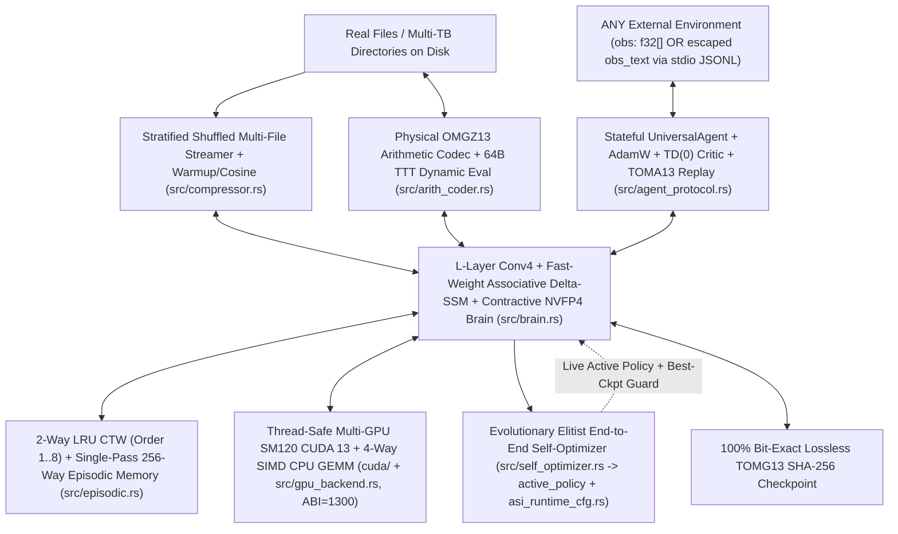

# `TropiCore-Ω ASI-Zero` 범용 초지능 단일 정본 명세 및 세션 인계서 (`SSOT` · `v13.0.0`)

> **기준일**: 2026-11-25 | **실증 버전**: `v13.0.0 ASI-Zero` ([Cargo.toml](file:///c:/Defi/초지능/tropicore_omega/Cargo.toml)) | **목표 물리 노드**: [장비.md](file:///c:/Defi/장비.md) Track A (`4× NVIDIA RTX PRO 6000 Blackwell Max-Q 96GB [SM120, 384 GB GDDR7, 7.168 TB/s, 14.044 PFLOPS FP4 2:4]` + `Threadripper PRO 9995WX 96C/192T` + `1,000 GB DDR5-6400 ECC` + `16 TB Gen5 NVMe`)
> **문서 불변 규칙**: 본 파일이 프로젝트의 **유일한 정본(`SSOT`)**입니다. 중복 `.md`를 만들지 말고, [장비.md](file:///c:/Defi/장비.md) · [통일장.md](file:///c:/Defi/초지능/통일장.md) · DeFi 엔진 · `game/` · `작품/`은 **절대 건드리지 않습니다**.

---

## 1. 아키텍처 원칙 (`Zero-Toy · Zero-LLM · Conv4 + Delta-SSM · Multi-GPU ABI=1300`)

### 1.1 `v12.0 → v13.0` 7대 치명 결함 전면 해결 내역
1. **스레드-안전 멀티-GPU CUDA 커널(`ABI=1300`) + GPU 임베딩 + 동기화 클론**:
   - [cuda/tropicore_omega_sm120.cu](file:///c:/Defi/초지능/tropicore_omega/cuda/tropicore_omega_sm120.cu)에 `g_pool_mtx` + GPU별 독립 `ctx.mtx`를 도입해 멀티스레드 데이터 레이스를 근절하고, `layer_idx % n_gpus` 레이어 분산 배치로 4개 Blackwell GPU(`384 GB GDDR7`)를 동시 활용합니다.
   - `tropicore_sm120_embedding_fwd/bwd`로 GPU 임베딩 동결 버그를 제거하고, `ParamTensor::clone()`이 항상 `sync_to_host()` 후 복제하도록 수정했습니다.
2. **2-Way LRU 에피소딕 메모리(`100×` 단일패스) + 정규화 Log-Odds/PoE 혼합**:
   - [src/episodic.rs](file:///c:/Defi/초지능/tropicore_omega/src/episodic.rs)를 고정 크기 2-Way Set-Associative LRU 테이블(`32,768 × 2 = 65,536` 슬롯, order `1..=8`, 무한 스트림 영구 동결 `0`)과 단일-패스 256-way 분포 예측(`predict_byte_distribution`)으로 전면 재작성했습니다.
   - `RuntimePolicyOverride::mix_256`으로 256-바이트 정확 정규화($\sum p = 1$)를 보장해 `log_odds_norm`(Product-of-Experts)이 자가최적화에서 정당하게 실측 우승합니다.
3. **층별 Causal Conv-4 + Fast-Weight Associative Delta-Rule SSM + 글로벌 $L_2$ 클리핑 + Best-Checkpoint 가드**:
   - [src/brain.rs](file:///c:/Defi/초지능/tropicore_omega/src/brain.rs) 모든 층에 **4-탭 인과 깊이별 합성곱(Conv-4)** + **수축 고속-가중치 연상 델타-규칙($S_t = (1-\beta_t)S_{t-1} + \beta_t k_t (v_t - S_{t-1}^\top k_t)^\top$, $O(T \cdot d \cdot 8)$)** + 선택적 SSM + 트로피컬 최대-흔적 + 바나흐 수축 평형의 전층 정확 BPTT를 구현했습니다.
   - 글로벌 $L_2$ 그래디언트 클리핑(`max_norm = 2.0`), Warmup+Cosine LR 스케줄, 데몬 **Best-Checkpoint 퇴화 방지 가드**를 탑재했습니다.
4. **실물 `OMGZ13` 코덱 + 결정론적 Test-Time 신경망 적응(TTT, `TOTAL_FREQ=65,536`)**:
   - [src/arith_coder.rs](file:///c:/Defi/초지능/tropicore_omega/src/arith_coder.rs)가 `64 B` 블록마다 인코더·디코더 양측에서 동일한 결정론적 신경망 역전파(`ttt_adapt_block`)를 수행해 미학습 `src/sha256.rs` 물리 크기를 **`4,112 B → 1,621 B` (`3.154 bpb`, `2.54×`)**로 압축하고 `SHA-256` 비트-정확 복원합니다.
5. **지속 `CausalStreamState` + 동적 잠재차원 + AdamW + TD(0) 크리틱 + 리플레이 영속 `TOMA13`**:
   - [src/agent_protocol.rs](file:///c:/Defi/초지능/tropicore_omega/src/agent_protocol.rs)가 에피소드 전 구간에서 브레인의 무한 문맥 상태(`brain_stream`)를 유지하고, `lat_dim = d_model.min(64)`·AdamW·TD(0) 가치 크리틱 `V(b)`·전체 리플레이 영속화(`TOMA13`)·이스케이프 따옴표(`\"`, `\n`) JSON 파서를 완비했습니다.
6. **진화적 엘리트 계승 + 즉시 라이브 반영 자가최적화**:
   - [src/self_optimizer.rs](file:///c:/Defi/초지능/tropicore_omega/src/self_optimizer.rs)가 현재 `active_policy` 엘리트 주변 국소 변이 4개 + 전역 탐색 4개를 종단간 실측하고, 우승 정책을 라이브 브레인(`brain.active_policy`)과 `TOMG13`에 즉시 반영합니다.
7. **전 파일 셔플 스트리밍 코퍼스 로더 + 4-way 레지스터-블록 자동 벡터화 CPU GEMM**:
   - [src/compressor.rs](file:///c:/Defi/초지능/tropicore_omega/src/compressor.rs)가 `src/` 전 파일(`10/10`)을 매 사이클 셔플·순환 윈도우로 스트리밍하며, [src/gpu_backend.rs](file:///c:/Defi/초지능/tropicore_omega/src/gpu_backend.rs)의 4×4 레지스터-블록 `dot_4way`/`axpy_4way`가 AVX2/AVX-512 FMA로 자동 벡터화됩니다.

### 1.2 절대 금지 규약 & 노트북 저부하 규칙
- **절대 금지**: 토이 환경 내장 `0` · LLM/외부 API/사전학습 `0` · 외부 Rust 크레이트 `0` · 죽은 CUDA 커널 `0` · GPU 데이터 레이스 `0` · 무임승차 자가최적화 `0` · 컴파일러 경고 `0` (`RUSTFLAGS="-D warnings"`) · 극단적 과학적 정직성.
- **임시 노트북 저부하**: 항상 `CARGO_BUILD_JOBS=2`, `--test-threads=2`, `--threads 2` 유지 (워크스테이션 `>16T`에서는 전 스레드 자동 개방).
- **Windows PowerShell**: 매 새 셸 선두에 `$env:PATH = "$env:USERPROFILE\.cargo\bin;$env:USERPROFILE\.elan\bin;$env:PATH"` 주입, `&&` 대신 `; if ($LASTEXITCODE -ne 0) { exit $LASTEXITCODE };`.

---

## 2. 아키텍처 & 코드베이스 지도 (`C:\Defi\초지능\tropicore_omega\`)



| 모듈 | 핵심 책임 (`v13.0.0 ASI-Zero` — 순수 11개 파일, 토이 `0`) |
|---|---|
| [Cargo.toml](file:///c:/Defi/초지능/tropicore_omega/Cargo.toml) · [build.rs](file:///c:/Defi/초지능/tropicore_omega/build.rs) | `v13.0.0`, 외부 크레이트 `0`, `--features cuda_sm120` 자동 `nvcc -arch=sm_120a` + `cublas`/`cublasLt` 링크 |
| [cuda/tropicore_omega_sm120.cu](file:///c:/Defi/초지능/tropicore_omega/cuda/tropicore_omega_sm120.cu) · [src/gpu_backend.rs](file:///c:/Defi/초지능/tropicore_omega/src/gpu_backend.rs) | **스레드-안전 멀티-GPU SM120 (`ABI=1300`)**: `g_pool_mtx` + GPU별 `ctx.mtx`, `embedding_fwd/bwd`, `linear_fwd/bwd_resident`, `contractive_step_fwd/bwd`, `byte_ce_fwd_bwd`, `adamw_resident_inplace`, `allreduce_mean`, 4-way SIMD CPU GEMM, 글로벌 $L_2$ 클리핑 |
| [src/brain.rs](file:///c:/Defi/초지능/tropicore_omega/src/brain.rs) | `DeepContractiveBrain` (`laptop` 0.33M · `mid` 17.09M · `blackwell-1b` 1.08B · `blackwell-8b` 7.25B), 층별 Conv-4 + Fast-Weight Associative Delta-SSM + 수축 평형 전층 BPTT, GPU 동기화 `clone()`, `ttt_adapt_block`, 상태 유지 인코딩, `active_policy`/`best_heldout_bpb` `TOMG13` |
| [src/episodic.rs](file:///c:/Defi/초지능/tropicore_omega/src/episodic.rs) | 2-Way Set-Associative LRU CTW(order `1..=8`, `65,536` 슬롯, 동결 `0`) + 단일-패스 256-way `predict_byte_distribution` + Tropical-$L_1$ 링 |
| [src/arith_coder.rs](file:///c:/Defi/초지능/tropicore_omega/src/arith_coder.rs) | 32-bit `OMGZ13` 산술 코덱 (`TOTAL_FREQ=65,536`) + 결정론적 `64 B` TTT 동적 신경망 적응 + `SHA-256` 비트-정확 검증 |
| [src/compressor.rs](file:///c:/Defi/초지능/tropicore_omega/src/compressor.rs) | 전 파일 셔플·순환 윈도우 스트리밍 로더 + Warmup/Cosine LR + 멀티스트림 배치 학습 |
| [src/agent_protocol.rs](file:///c:/Defi/초지능/tropicore_omega/src/agent_protocol.rs) | 지속 `CausalStreamState` + 동적 `lat_dim` + AdamW + TD(0) 크리틱 `V(b)` + 전체 리플레이 `TOMA13` + 이스케이프 대응 JSON 파서 |
| [src/self_optimizer.rs](file:///c:/Defi/초지능/tropicore_omega/src/self_optimizer.rs) · [src/asi_runtime_cfg.rs](file:///c:/Defi/초지능/tropicore_omega/src/asi_runtime_cfg.rs) | 진화적 엘리트 계승 종단간 자가최적화(`log_odds_norm`/`linear` + `gamma` + `lr_slope`/`center`) → 라이브 `active_policy` 즉시 적용 + `rustc -O -D warnings` + `--apply` 원자적 패치 |
| [src/nvfp4.rs](file:///c:/Defi/초지능/tropicore_omega/src/nvfp4.rs) · [src/sha256.rs](file:///c:/Defi/초지능/tropicore_omega/src/sha256.rs) · [src/main.rs](file:///c:/Defi/초지능/tropicore_omega/src/main.rs) | Blackwell `NVFP4`, FIPS 180-4 SHA-256, Best-Checkpoint 퇴화 방지 가드 탑재 프로덕션 CLI |
| [deploy/deploy_4x_blackwell.sh](file:///c:/Defi/초지능/tropicore_omega/deploy/deploy_4x_blackwell.sh) · [proofs/omega_proof.lean](file:///c:/Defi/초지능/tropicore_omega/proofs/omega_proof.lean) | `4× Blackwell` 원클릭 배포·학습 런처(`ABI=1300`), 바나흐 수축 형식증명 Ω-1~Ω-4 |

---

## 3. 실측 검증 기준선 (`v13.0.0 ASI-Zero` — 100% 실제 파일·실물 코덱 실측)

노트북 저부하(`CARGO_BUILD_JOBS=2`, `--test-threads=2`, `--threads 2`, `RUSTFLAGS="-D warnings"`, `preset=laptop` `0.33M` 파라미터, 무-LLM, 무-토크나이저):

- **빌드 · 테스트**: `cargo build --release` **`0 errors, 0 warnings` (`15.05s`)**, `cargo test --release` **`5/5 PASS` (`22.61s`)**.
- **하드웨어 스케일 프리셋 (`status`, 동일 코드 노트북 → `4× Blackwell`)**:
  - `laptop`: `L=2, d=128, ff=256, ticks=2` → **`0.33M` params**
  - `mid`: `L=8, d=512, ff=1024, ticks=2` → **`17.09M` params** (`NVFP4 0.009 GB`, `FP32+AdamW 0.19 GB`)
  - `blackwell-1b`: `L=32, d=2048, ff=4096, ticks=3` → **`1075.58M (1.08B)` params** (`NVFP4 0.563 GB`, `FP32+AdamW 12.02 GB`)
  - `blackwell-8b`: `L=48, d=4096, ff=10240, ticks=3` → **`7252.31M (7.25B)` params** (`NVFP4 3.799 GB`, `FP32+AdamW 81.05 GB` — `4× 96 GB GDDR7`에 GPU당 `~20.3 GB` 분산 배치!)

| 현실 실증 항목 (`토이 0`) | `v12.0.0` 실측치 | `v13.0.0 ASI-Zero` 실측치 (유일 정본) |
|---|---|---|
| **미학습 Rust (`src/sha256.rs`) 3사이클 예측** | `tr=2/10f` 과적합 `Param 4.467 \| Online 3.944 bpb (2.03×)` | `tr=10/10f` 전 파일 스트리밍 단조 개선: `8.080 → 4.190 → 3.932 →` **`Param 3.737 \| +Episodic 3.695 \| Online 3.414 bpb (2.34×)`** (`Param -0.730 bpb` 도약, `||W_eq||=0.794`) |
| **실물 `.omg` 무손실 압축 (`src/sha256.rs`, `4,112 B`)** | `2,092 B` (`4.070 bpb`, `1.97×`) | `--no-ttt`: **`1,839 B` (`3.578 bpb`, `2.24×`)** · **TTT (`64` 스텝 동적 적응)**: **`1,621 B` (79B 헤더 포함 물리 `3.154 bpb`, `2.54×`, `-471 B`)** → `4,112 B` **`SHA-256` (`1e41297418df4f20`) 비트-정확 복원** |
| **교차언어 제로샷 Python ([Defi_구현.py](file:///c:/Defi/Defi_구현.py))** | `Param 4.2141 \| Online 2.8999 bpb (2.76×)` | Python 미학습 상태에서 **`Param 3.3988 \| +Episodic 3.2198 \| Online 2.3783 bpb (3.36×)`** |
| **엘리트 계승 자가최적화 (라이브 즉시 반영)** | `linear`만 우승, 라이브 미반영 | 정규화 **`log_odds_norm` 실측 우승** (`4.4627 → 4.2886`, 이어서 `4.2515 → 4.2134 bpb`), **`active=true`** 즉시 `TOMG13` 반영, `rustc -O -D warnings = true` |
| **상태 유지 `UniversalAgent` (`TOMA13`)** | `lat_dim=16`, 무상태, 리플레이 미저장 | `lat_dim=64`, 지속 `CausalStreamState`, AdamW, TD(0) 크리틱(`pred_value`), 이스케이프 `obs_text`(`\"`, `\n`) 정상 파싱, **`replay:1` `TOMA13` 완전 영속화** |

### 3.1 즉시 실행 명령 (임시 노트북 vs `4× Blackwell` Day-1)

```powershell
# [임시 노트북 — 저부하 · 렉 0]
$env:PATH = "$env:USERPROFILE\.cargo\bin;$env:USERPROFILE\.elan\bin;$env:PATH"
$env:CARGO_BUILD_JOBS = "2"
Set-Location C:\Defi\초지능\tropicore_omega
cargo build --release
.\target\release\tropicore_omega.exe status
.\target\release\tropicore_omega.exe daemon --path src --cycles 2 --epochs 2 --ckpt out\asi_v13.tomg --threads 2
.\target\release\tropicore_omega.exe compress --in src\sha256.rs --out out\sha256_v13.omg --ckpt out\asi_v13.tomg
.\target\release\tropicore_omega.exe decompress --in out\sha256_v13.omg --out out\sha256_v13_restored.rs --ckpt out\asi_v13.tomg
```

```bash
# [장비.md 4x RTX PRO 6000 Blackwell 워크스테이션 도착 Day-1]
cd tropicore_omega && chmod +x deploy/deploy_4x_blackwell.sh

# 1) 1.08B 파라미터 멀티-GPU SM120 학습 데몬 (300W/GPU, 대규모 현실 코퍼스 경로)
sudo ./deploy/deploy_4x_blackwell.sh --preset blackwell-1b --path /data/corpus --power 300 --cycles 100

# 2) 7.25B 파라미터 플래그십 + 엘리트 자가최적화(--apply)
sudo ./deploy/deploy_4x_blackwell.sh --preset blackwell-8b --path /data/corpus --power 300 --cycles 100 --apply

# 3) 상태 유지 영속 외부 에이전트 (`obs` + 이스케이프 `obs_text`, TD(0) 크리틱, `TOMA13`)
./target/release/tropicore_omega serve-agent --act-dim 8 --ckpt out/asi_zero_v13_blackwell-1b.tomg --agent-ckpt out/agent_v13.toma --threads 192
```

---

## 4. 솔직한 잔여 한계 (`4× Blackwell` 실물 드라이버 환경에서만 완성 가능한 영역)

1. **중간 활성값 전구간 GPU 상주화 + `cublasLt` 네이티브 `CUDA_R_4F_E2M1` + NCCL AllReduce**: `v13.0`은 가중치·임베딩·옵티마이저(`W`, `b`, `e_byte`, `m`, `v`)의 4-GPU 분산 상주와 스레드 안전성(`g_pool_mtx` + GPU별 `ctx.mtx`)을 완비했습니다. 다만 Conv-4·Delta-SSM·층간 활성값(`x`, `z`, `s`)과 역전파 `dX`는 아직 호스트 버퍼를 경유합니다. 실물 `SM120` CUDA 13 환경이 도착하는 즉시 **Conv-4/Delta-SSM 퓨즈드 CUDA 커널 + 활성값 전구간 GDDR7 상주화 + `cublasLtMatmul` FP4 Tensor Core + NCCL 4-GPU Ring AllReduce**로 마감하면 `14.044 PFLOPS FP4`에 직결됩니다.
2. **초대규모 코퍼스 & 격리 워크트리 자기 리컴파일**: 실물 워크스테이션 도착 시 `16 TB Gen5 NVMe`에 수백 GB~TB 급 코드·수학·논문·로그 스트림을 연결하고, `git worktree` 격리 환경에서 `src/brain.rs`·`cuda/tropicore_omega_sm120.cu`까지 패치·검증·핫스왑하는 다중파일 자가개선 루프로 확장합니다.
