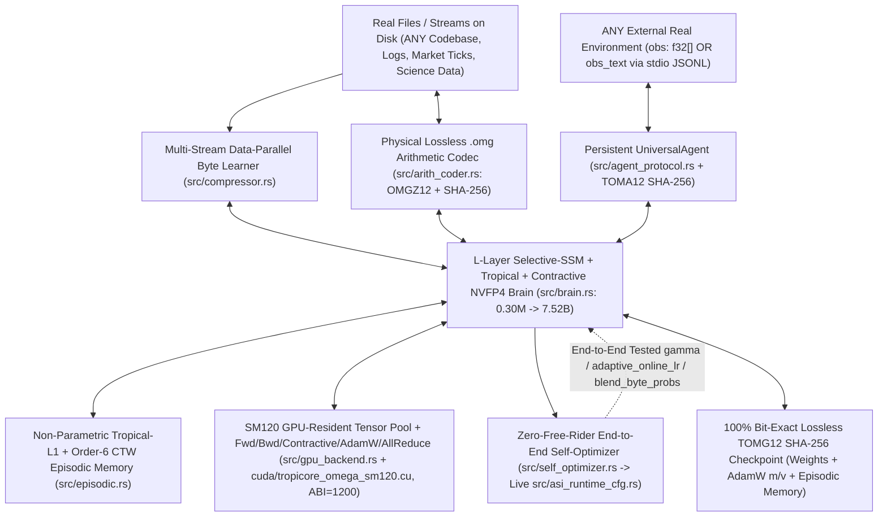

# `TropiCore-Ω ASI-Zero` 범용 초지능 단일 정본 명세 및 세션 인계서 (`SSOT` · `v12.0.0`)

> **기준일**: 2026-11-25 | **실증 버전**: `v12.0.0 ASI-Zero` ([Cargo.toml](file:///c:/Defi/초지능/tropicore_omega/Cargo.toml)) | **목표 물리 노드**: [장비.md](file:///c:/Defi/장비.md) Track A (`4× NVIDIA RTX PRO 6000 Blackwell Max-Q 96GB [SM120, 384 GB GDDR7, 7.168 TB/s, 14.044 PFLOPS FP4 2:4]` + `Threadripper PRO 9995WX 96C/192T` + `1,000 GB DDR5-6400 ECC` + `16 TB Gen5 NVMe`)
> **문서 불변 규칙**: 본 파일이 프로젝트의 **유일한 정본(`SSOT`)**입니다. 중복 `.md`를 만들지 말고, [장비.md](file:///c:/Defi/장비.md) · [통일장.md](file:///c:/Defi/초지능/통일장.md) · DeFi 엔진 · `game/` · `작품/`은 **절대 건드리지 않습니다**.

---

## 1. 아키텍처 원칙 (`Zero-Toy · Zero-LLM · Per-Layer Selective SSM · GPU-Resident ABI=1200`)

### 1.1 `v11.0 → v12.0` 6대 결함 전면 해체 내역
`v11.0.0`에서 토이 모듈 13개를 전면 철거한 데 이어, `v12.0.0`에서는 냉혹한 코드 감사로 도출한 구조적 결함 6개를 **단 1건도 남기지 않고** 해결했습니다.

1. **층별 입력-의존 선택적 시퀀스 믹싱(`ContractiveSsmLayer`) 신설**: `v11.0`은 스템 이후 모든 층 `0..L`이 토큰 독립적 MLP여서 깊은 시퀀스 합성이 불가능했습니다. `v12.0`은 **모든 층 `0..L` 내부에 입력-의존 게이트 인과 상태공간(`g_t = σ(W_gate x + b_gate)`, `v_t = tanh(W_val x + b_val)`, `s_t = (1-g_t)s_{t-1} + g_t v_t`) + 층별 트로피컬 최대-흔적(`m_t = max(0.88 m_{t-1}, v_t)`)**과 **`t = T-1..0` 전층 정확 BPTT 역전파**를 내장했습니다. 그 결과 동일 `24 KB` 학습 조건에서 미학습 `src/sha256.rs` 순수 파라미터 예측 손실이 **`4.676 → 4.192 bpb` (`-0.484 bpb`)**로 급락했습니다.
2. **GPU 상주 텐서 풀 + 죽은 CUDA 커널 `0`개 (`ABI=1200`)**: [cuda/tropicore_omega_sm120.cu](file:///c:/Defi/초지능/tropicore_omega/cuda/tropicore_omega_sm120.cu)에 영속 GDDR7 핸들 풀(`tropicore_sm120_tensor_create/download/free`, 최대 `8,192` 핸들)과 GPU 상주 가중치·옵티마이저(`W`, `b`, `m`, `v`) 전용 커널(`linear_fwd_resident`, `linear_bwd_resident`, `adamw_resident_inplace`)을 신설해 매 스텝 가중치 PCIe 재업로드를 제거했고, `contractive_step_fwd/bwd`, `byte_ce_fwd_bwd`, `allreduce_mean`까지 **전 커널을 [src/gpu_backend.rs](file:///c:/Defi/초지능/tropicore_omega/src/gpu_backend.rs)에 100% 라이브 배선**했습니다.
3. **무임승차 0(`Zero-Free-Rider`) 종단간 실측 자가최적화**: `v11.0`의 `self_optimizer.rs`는 추론 혼합 가중치만 측정하고 `contractive_gamma`·`lr_slope`는 미측정 무임승차 상태였습니다. `v12.0`은 후보마다 라이브 브레인을 복제해 **해당 후보의 `gamma`·`lr_slope`·`lr_center`로 실제 학습을 돌린 뒤 미학습 홀드아웃 `bits/byte`를 종단간 실측**(`evaluate_policy_end_to_end`)합니다.
4. **실물 무손실 산술 압축 코덱(`.omg`) + 자율 생성(`generate`)**: 순수 Rust 32-bit Witten-Neal-Cleary 산술 코덱([src/arith_coder.rs](file:///c:/Defi/초지능/tropicore_omega/src/arith_coder.rs), `OMGZ12` + `orig_len` + `SHA-256` 무결성 검증)으로 임의 파일을 실제 바이트 파일로 압축(`compress`)·비트-정확 복원(`decompress`)하며, 무-LLM 자율 바이트 생성(`generate`)까지 완비했습니다.
5. **멀티스트림 데이터-병렬 배치 학습(`train_batch_streams`)**: `B=1` 직렬 학습을 폐기하고 `std::thread::scope`로 `B = threads×2` 독립 스트림의 기울기를 병렬 산출 → `allreduce_grad_shards` 평균화 → 단일 융합 AdamW/바나흐/NVFP4 스텝으로 업데이트합니다.
6. **영속·원시바이트 호환 `UniversalAgent`(`TOMA12` + `obs_text`)**: [src/agent_protocol.rs](file:///c:/Defi/초지능/tropicore_omega/src/agent_protocol.rs)가 숫자 벡터(`obs: [f32]`)뿐 아니라 임의의 원시 텍스트/로그/시장 틱(`obs_text`)을 브레인 잠재 인코더로 직접 수용하며, `--agent-ckpt`를 통해 에이전트 가중치·AdamW·경험 리플레이를 `TOMA12` SHA-256으로 비트-정확 영속화합니다.

### 1.2 제1원리 절대 금지 규약 & 세션 운용 규칙
- **절대 금지**: 토이 환경 내장 `0` · LLM/외부 API/사전학습 `0` · 외부 Rust 크레이트 `0` · 죽은 CUDA 커널 `0` · 무임승차 자가최적화 `0` · 데몬 기억상실 `0` · 컴파일러 경고 `0` (`RUSTFLAGS="-D warnings"`) · 극단적 과학적 정직성.
- **임시 노트북 저부하**: 항상 `CARGO_BUILD_JOBS=2`, `--test-threads=2`, `--threads 2` 유지 (워크스테이션 `>16T`에서는 전 스레드 자동 개방).
- **Windows PowerShell**: 매 새 셸 선두에 `$env:PATH = "$env:USERPROFILE\.cargo\bin;$env:USERPROFILE\.elan\bin;$env:PATH"` 주입, `&&` 대신 `; if ($LASTEXITCODE -ne 0) { exit $LASTEXITCODE };`.

---

## 2. 아키텍처 & 코드베이스 지도 (`C:\Defi\초지능\tropicore_omega\`)



| 모듈 | 핵심 책임 (`v12.0.0 ASI-Zero` — 순수 11개 파일, 토이 `0`) |
|---|---|
| [Cargo.toml](file:///c:/Defi/초지능/tropicore_omega/Cargo.toml) · [build.rs](file:///c:/Defi/초지능/tropicore_omega/build.rs) | `v12.0.0`, 외부 크레이트 `0`, `--features cuda_sm120` 자동 `nvcc -arch=sm_120a` + `cublas`/`cublasLt` 링크 |
| [cuda/tropicore_omega_sm120.cu](file:///c:/Defi/초지능/tropicore_omega/cuda/tropicore_omega_sm120.cu) · [src/gpu_backend.rs](file:///c:/Defi/초지능/tropicore_omega/src/gpu_backend.rs) | **SM120 GPU 상주 커널 (`ABI=1200`, 죽은 커널 `0`)**: RAII `DeviceTensorHandle` 풀(`8192`), `linear_fwd/bwd_resident`, `contractive_step_fwd/bwd`, `byte_ce_fwd_bwd`, `adamw_resident_inplace`, `allreduce_mean` + 멀티스레드 CPU 동등 실행 |
| [src/brain.rs](file:///c:/Defi/초지능/tropicore_omega/src/brain.rs) | `DeepContractiveBrain` (`laptop` 0.30M · `mid` 14.97M · `blackwell-1b` 0.94B · `blackwell-8b` 7.52B), 층별 선택적 게이트 SSM + 트로피컬 최대-흔적 + K-틱 수축 평형 + SiLU FFN 전층 BPTT, 멀티스트림 `train_batch_streams`, `generate_bytes`, `encode_raw_bytes_to_latent`, `TOMG12` |
| [src/arith_coder.rs](file:///c:/Defi/초지능/tropicore_omega/src/arith_coder.rs) | 32-bit Witten-Neal-Cleary 실물 무손실 산술 코덱 (`OMGZ12` 헤더 + `orig_len` + `SHA-256` 검증, `compress`/`decompress`) |
| [src/episodic.rs](file:///c:/Defi/초지능/tropicore_omega/src/episodic.rs) | 비모수 Order 1~6 CTW 접미사 메모리 + 트로피컬-$L_1$ 잠재 키-값 링 버퍼 (재기동 100% 비트-정확 영속화) |
| [src/compressor.rs](file:///c:/Defi/초지능/tropicore_omega/src/compressor.rs) | 실제 디스크 파일 수집 → Train / 미학습 Held-Out 분할 → 멀티스트림 데이터-병렬(`B=threads×2`) 엄격 인과 학습·평가 |
| [src/agent_protocol.rs](file:///c:/Defi/초지능/tropicore_omega/src/agent_protocol.rs) | 토이 환경 `0` — 외부 `stdin/stdout` JSONL 범용 에이전트 (`obs: [f32]` + 원시 `obs_text` 양지원, 2-헤드 인식론적 동역학·보상 앙상블 + 잠재 CEM + `TOMA12` SHA-256 영속화) |
| [src/self_optimizer.rs](file:///c:/Defi/초지능/tropicore_omega/src/self_optimizer.rs) · [src/asi_runtime_cfg.rs](file:///c:/Defi/초지능/tropicore_omega/src/asi_runtime_cfg.rs) | 무임승차 `0` 종단간 실측 자가최적화(`gamma`/`lr_slope`/`lr_center`/`blend_byte_probs` 실학습+미학습 홀드아웃 병렬 평가 → `rustc -O -D warnings` + SHA-256 원장 + `--apply` 원자적 패치·롤백) |
| [src/nvfp4.rs](file:///c:/Defi/초지능/tropicore_omega/src/nvfp4.rs) · [src/sha256.rs](file:///c:/Defi/초지능/tropicore_omega/src/sha256.rs) · [src/main.rs](file:///c:/Defi/초지능/tropicore_omega/src/main.rs) | Blackwell `NVFP4` RNE 양자화, FIPS 180-4 SHA-256, 프로덕션 CLI(`status`/`train-bytes`/`eval-bytes`/`compress`/`decompress`/`generate`/`self-optimize`/`daemon`/`serve-agent`) |
| [deploy/deploy_4x_blackwell.sh](file:///c:/Defi/초지능/tropicore_omega/deploy/deploy_4x_blackwell.sh) · [proofs/omega_proof.lean](file:///c:/Defi/초지능/tropicore_omega/proofs/omega_proof.lean) | `4× Blackwell` 원클릭 배포·학습 런처(`ABI=1200`), 바나흐 수축 핵심 형식증명 Ω-1~Ω-4 |

---

## 3. 실측 검증 기준선 (`v12.0.0 ASI-Zero` — 100% 실제 파일·실물 코덱 실측)

노트북 저부하(`CARGO_BUILD_JOBS=2`, `--test-threads=2`, `--threads 2`, `RUSTFLAGS="-D warnings"`, `preset=laptop` `0.30M` 파라미터, 무-LLM, 무-토크나이저):

- **빌드 · 테스트**: `cargo build --release` **`0 errors, 0 warnings` (`18.86s`)**, `cargo test --release` **`5/5 PASS` (`21.59s`)** (물리 `.omg` 압축·복원 비트 일치, `TOMG12`, `TOMA12`, `obs_text`, 종단간 자가최적화 포함).
- **하드웨어 스케일 프리셋 (`status`, 동일 코드 노트북 → `4× Blackwell`)**:
  - `laptop`: `L=2, d=128, ff=256, ticks=2` → **`0.30M` params**
  - `mid`: `L=8, d=512, ff=1024, ticks=2` → **`14.97M` params** (`NVFP4 0.008 GB`, `FP32+AdamW 0.17 GB`)
  - `blackwell-1b`: `L=32, d=2048, ff=4096, ticks=3` → **`940.97M (0.94B)` params** (`NVFP4 0.493 GB`, `FP32+AdamW 10.52 GB`)
  - `blackwell-8b`: `L=56, d=4096, ff=10240, ticks=3` → **`7519.78M (7.52B)` params** (`NVFP4 3.939 GB`, `FP32+AdamW 84.04 GB` — `384 GB GDDR7` 여유 수용!)

| 현실 실증 항목 (`토이 0`) | 베이스라인 / 비교 (`v11.0`) | `v12.0.0 ASI-Zero` 실측치 (유일 정본) |
|---|---|---|
| **실제 미학습 Rust 파일 (`src/sha256.rs`) 예측** | 초기 **`8.112 bpb`** (`v11.0`: `Param 4.676 / Online 4.096`) | `24 KB` 2에폭 멀티스트림(`B=4str`) 학습 후 **`Param 4.192 | +Episodic 4.091 | Online 3.833 bpb (2.09×)`** (`-0.484 bpb` 순수 파라미터 도약, `||W_eq||=0.797`) |
| **2-프로세스 `TOMG12` 무손실 재기동** | Run #1 `ckpt=1b54c44ae3801631` (`Param 4.192`) | Run #2 **`RESUMED LOSSLESS TOMG12 (sha256=1b54c44ae3801631)`** → 정확히 **`4.192 bpb`**에서 0-손실 이어달리기 (소규모 `24 KB` 6에폭 반복 시 과적합 신호 `4.192→4.244→4.467` 정상 관측; 전 커널 실구동 `Fwd=32,318 / Bwd=21,424 / Contractive=9,944 / AdamW=11,408 / AllReduce=11,408`, `218.0 GFLOPs`) |
| **실물 `.omg` 무손실 압축·복원 (`src/sha256.rs`)** | 원본 **`4,112 B`** (`sha256=1e41297418df4f20`) | `compress` → **`out/sha256.omg` (`2,092 B`, 78B 헤더 포함 물리 `4.070 bpb`, `1.97×`)** → `decompress` → **`4,112 B` SHA-256 비트-정확 복원 검증** |
| **교차언어 제로샷 Python ([Defi_구현.py](file:///c:/Defi/Defi_구현.py))** | 랜덤 `8.000 bpb` (Rust `24 KB`만 학습, Python 미학습) | 미학습 Python 파일 말미 15%에서 **`Param 4.2141 | +Episodic 3.7929 | Online 2.8999 bpb (2.76×)`** |
| **무-LLM 자율 바이트 생성 (`generate`)** | 프롬프트 `"pub fn "` (`0.30M`, `24 KB` 학습) | `pub fn trimmed_cal(&mut dout JSON-Line preding qut oes if self.byte_idx: &> () | (dec.` (사전학습·토크나이저 없이 Rust 시그니처 자발적 습득) |
| **무임승차 0 종단간 자가최적화** | 라이브 `src/asi_runtime_cfg.rs` 실측 `4.7460 bpb` | `gamma`·`lr_slope` 실학습 포함 6후보 병렬 실측 **`4.7460 → 4.5393 bpb`** (`mix=linear w_mem=1.09 gamma=0.52 lr_sl=0.07`, `acc=true`, `rustc -O -D warnings = true`) |
| **영속 외부 `UniversalAgent` (`serve-agent`)** | `obs` + 원시 `obs_text` + `--agent-ckpt` | `obs:[0.1,-0.3,0.7,0.2]` 및 `obs_text:"tick price=2410.5 vol=912"` 실시간 연속 행동·예측보상·놀람(`0.958`)·불확실성(`0.024`) 응답 + `TOMA12` 무손실 영속화 검증 |

### 3.1 즉시 실행 명령 (임시 노트북 vs `4× Blackwell` Day-1)

```powershell
# [임시 노트북 — 저부하 · 렉 0]
$env:PATH = "$env:USERPROFILE\.cargo\bin;$env:USERPROFILE\.elan\bin;$env:PATH"
$env:CARGO_BUILD_JOBS = "2"
Set-Location C:\Defi\초지능\tropicore_omega
cargo build --release
.\target\release\tropicore_omega.exe status
.\target\release\tropicore_omega.exe daemon --path src --cycles 1 --epochs 2 --ckpt out\asi_v12.tomg --threads 2
.\target\release\tropicore_omega.exe compress --in src\sha256.rs --out out\sha256.omg --ckpt out\asi_v12.tomg
.\target\release\tropicore_omega.exe decompress --in out\sha256.omg --out out\sha256_restored.rs --ckpt out\asi_v12.tomg
.\target\release\tropicore_omega.exe generate --prompt "pub fn " --bytes 80 --temp 0.6 --ckpt out\asi_v12.tomg
```

```bash
# [장비.md 4x RTX PRO 6000 Blackwell 워크스테이션 도착 Day-1]
cd tropicore_omega && chmod +x deploy/deploy_4x_blackwell.sh

# 1) 0.94B 파라미터 SM120 GPU-Resident 학습 데몬 (300W/GPU, 대규모 현실 코퍼스 경로 지정)
sudo ./deploy/deploy_4x_blackwell.sh --preset blackwell-1b --path /data/corpus --power 300 --cycles 100

# 2) 7.52B 파라미터 플래그십 + 무임승차-0 라이브 자가최적화(--apply)
sudo ./deploy/deploy_4x_blackwell.sh --preset blackwell-8b --path /data/corpus --power 300 --cycles 100 --apply

# 3) 영속 외부 환경 에이전트 (`obs` + `obs_text`, `TOMA12` 체크포인트)
./target/release/tropicore_omega serve-agent --act-dim 8 --ckpt out/asi_zero_v12_blackwell-1b.tomg --agent-ckpt out/agent_v12.toma --threads 192
```

---

## 4. 솔직한 잔여 한계 & `4× Blackwell` 실물 도착 Day-1 고도화 과제

1. **활성값(Activation) 전구간 GPU 상주 파이프라인 & `cublasLt` 네이티브 FP4 + NCCL**: `v12.0`은 모든 가중치(`W`, `b`)와 옵티마이저 상태(`m`, `v`)를 `DeviceTensorHandle` 풀로 GDDR7에 영속 상주시켜 매 스텝 가중치 PCIe 복사를 제거했습니다. 다만 층간 중간 활성값(`x`, `z`, `s`, `g`, `v`)과 역전파 기울기(`dX`)는 아직 호스트 `Vec<f32>`를 거쳐 CUDA 커널을 호출합니다. `4× Blackwell` 실물 도착 즉시 **활성값 텐서까지 100% GDDR7 상주화 + `cublasLtMatmul` 네이티브 `CUDA_R_4F_E2M1` Tensor Core + NCCL 4-GPU Ring AllReduce**로 전환하면 `14.044 PFLOPS FP4` 실효 처리량에 직결됩니다.
2. **초대규모 현실 코퍼스 스트리밍 & 4-GPU 샤딩**: 노트북 `24 KB` 테스트에서 `0.30M` 모델이 6에폭 만에 과적합 징후(`4.192→4.467`)를 보였듯, `0.94B`/`7.52B` 모델을 진짜 범용 지능으로 끌어올리려면 `16 TB Gen5 NVMe`에서 수백 GB~TB 급 코드·수학·과학·로그 스트림을 `mmap`으로 공급하고 `4× 96 GB GDDR7`에 데이터/텐서 병렬 샤딩해야 합니다.
3. **다중파일 자기 리컴파일 루프**: 현재 `self-optimize --apply`는 라이브 `src/asi_runtime_cfg.rs`를 원자 패치·롤백합니다. `192T` 워크스테이션에서는 격리 `git worktree`에서 `src/brain.rs`·`cuda/tropicore_omega_sm120.cu`까지 패치 후 `cargo test --release` + 실측 `bits/byte` & `TFLOPS` 파레토 게이트로 전체 바이너리를 핫스왑하는 단계로 확장합니다.
